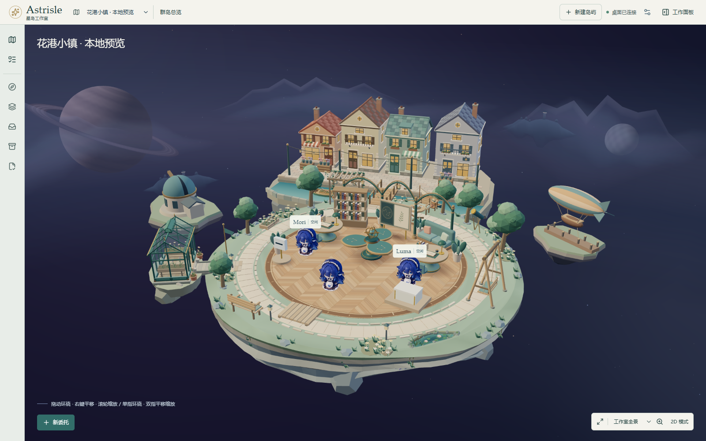
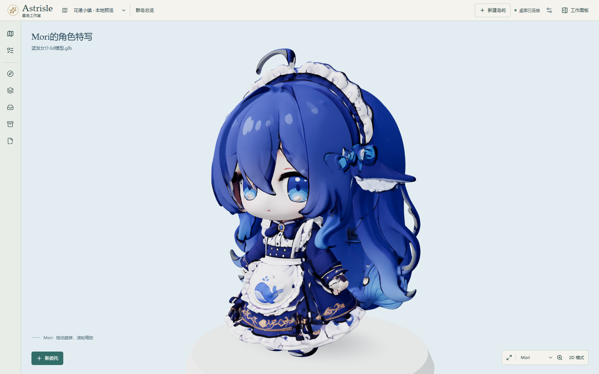
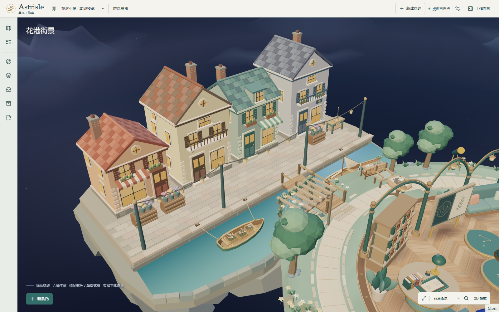

# Astrisle · 星岛工作室

把真实项目交给伙伴，在一座可以走进的工作室里观察、决策和验收。

[](https://www.electronjs.org/)
[](https://www.typescriptlang.org/)
[](https://react.dev/)
[](https://threejs.org/)
[](https://nodejs.org/)
[](https://www.sqlite.org/)
[](https://www.python.org/)
[](https://vite.dev/)
[](https://pnpm.io/)
[](https://vitest.dev/)

Astrisle 是一个面向 Windows 的多 Agent 桌面工作台。伙伴可以从零创建项目、修改代码、撰写报告和演示稿，并通过分工、交接、复核与返工推进委托。3D 场景呈现协作关系，工作面板提供文件、证据、权限和进度。

**第十四阶段开发预览。** 选中委托后，可以点岛上的伙伴，也可以在「伙伴与任务」中发起对话。伙伴根据这份委托的记录回答有关分工、交接、成果和复核的问题。点击回答附带的资料即可查看原任务、当时的文件版本或复核证据。[伙伴对话](#与伙伴对话)

第二至第五阶段已由 [PR #2：任务续跑、运行时保护与星岛角色配置](https://github.com/orange11-forever/Astrisle/pull/2) 合并。第六、七阶段已由 [PR #3：Windows 进程监督、岛屿散步与验收庆祝](https://github.com/orange11-forever/Astrisle/pull/3) 合并。自由视角和角色休闲见[第八阶段](docs/development/stage-8.md)，模型实测与角色导入见[第九阶段](docs/development/stage-9.md)，Windows 原项目写回与恢复见[第十阶段](docs/development/stage-10.md)。

第十阶段记录了 331 项自动化测试，包括原生写回的文件竞争、崩溃与恢复。第九阶段的 DeepSeek 实测为 9/9，详见[验证摘要](docs/validation/stage-9-live-model-summary.json)。



以下演示使用第十一阶段 Electron 桌面构建，以及当前角色配置引用的「蓝发女仆3d模型.glb」。

| 当前角色特写 | 花港街景 |
|---|---|
|  |  |

截图展示导入模型的效果；模型文件不随源码分发，首次启动仍提供默认回退角色，可在设置中导入自己的模型。

## 当前实现

| 模块 | 当前内容 |
|---|---|
| 桌面 | Electron 窗口与托盘、受限 preload 桥接、独立 Node 运行时、系统加密的 API 密钥存储 |
| 工作空间 | 创建或导入项目、独立工作副本、文件基线、候选整合、导出到新目录；已验收新增/修改的 Windows 写回、备份、核查与恢复 |
| 委托与协作 | SQLite 持久化、幂等派单、按伙伴名单分工、动态任务图、版本化交接、独立复核与返工、持久化动作回执与重启续接、运行时独占与调用代次校验 |
| 模型适配 | OpenAI-compatible Chat Completions、OpenAI Responses、Anthropic Messages、Gemini generateContent 四种协议 |
| 工作工具 | 文件检索/读取/写入/局部修改、明确授权的本机进程、Windows Job 进程树停止确认、联网检索和按域名授权的网页读取 |
| 成果审阅 | 历史版本、逐行差异、版本复核证据、定向返工和受影响成果重建 |
| 源稿发布 | Markdown 生成 Word 或 PowerPoint，CSV/TSV 生成 Excel。成品绑定源稿版本，支持结构回读与数据表独立数值核对 |
| 前端 | 360° 环绕与平移、花园星岛、自动坐椅／喝茶／荡秋千、散步与工位寻路、群岛管理、角色特写、验收彩纸礼炮、按需渲染、2D 模式和减少动效 |
| 角色配置 | GLB／自包含 glTF、3MF、STL、OBJ、FBX 导入，伴随资源复制、独立解析检查、自动居中与尺寸归一化、四方向调整、跨岛屿保存与资源共享 |
| 伙伴对话 | 3D 姓名牌和 2D 工作面板入口、按委托及伙伴区分的追问记录、任务与确切成果版本及复核证据的引用 |
| 运行预算 | 累计模型步数与活动时间、暂停后调整总额度、并发调用限额、预算恢复和返工续接 |

模型适配器已有协议测试，DeepSeek 的实际任务记录见第九阶段；这不代表所有厂商、模型和第三方兼容端点都已实测。兼容服务须支持工具调用，并填写其实际基础地址与模型名称。

## 本地启动

当前开发和验证环境是 Windows x64、Node.js 22.22、Python 3.12 和 pnpm 11.21。Node 至少需要 22.13，以提供本项目使用的 `node:sqlite`；Node 22 下出现 SQLite experimental 提示是已知现象。

Windows 进程监督和写回要求 Windows 10+ x64。测试和桌面构建会用系统 .NET Framework 4.x 的 C# 编译器生成 `dist/helpers/process-supervisor.exe` 和 `safe-apply.exe`；缺少编译器会使构建失败。原项目写回还要求本机固定 NTFS 磁盘，辅助程序缺失时保持不可用。

先准备 Node.js、Python、pnpm 和 Git，在 PowerShell 中执行：

```powershell
git clone https://github.com/orange11-forever/Astrisle.git
cd Astrisle

pnpm.cmd install --frozen-lockfile --ignore-scripts --store-dir .pnpm-store
node node_modules/esbuild/install.js
node node_modules/electron/install.js

python -m venv .venv
.venv\Scripts\python.exe -m pip install -r workers\office\requirements.txt

pnpm.cmd build
pnpm.cmd start
```

PowerShell 下使用 `.cmd`，避免系统禁用 `.ps1` 时无法启动 pnpm。依赖脚本在安装时关闭，再明确执行 esbuild 和 Electron 的安装器。项目 `.venv` 中的 `pypandoc_binary` 自带 Pandoc。已有工作区更新到本阶段后，再运行一次上面的 `pip install -r workers\office\requirements.txt`，然后重启桌面应用。

Electron 下载较慢时，可仅在当前 PowerShell 会话设置镜像后重试安装器：

```powershell
$env:ELECTRON_MIRROR = 'https://npmmirror.com/mirrors/electron/'
node node_modules/electron/install.js
```

开发模式：

```powershell
pnpm.cmd dev
```

此命令构建桌面进程、启动 Vite 和 Electron。前端支持热更新；修改桌面或运行时代码后需重启开发命令。单独访问 Vite 页面会标明“浏览器预览（内置角色）”。

**演示当前角色**时运行 `pnpm.cmd demo`。演示入口从正常桌面数据目录读取角色配置，只复制引用到的模型到临时演示空间。启动器核对模型文件哈希，等 Electron 画布实际绘制出配置中的角色后再显示窗口。日常使用 `pnpm.cmd start` 打开原工作区。

## 开始工作

1. 在设置中选择 API 协议，填写基础地址、模型名称和密钥，保存并测试连接。密钥不应写进项目文件或聊天。
2. 创建并命名岛屿，或导入已有项目。**一座岛屿对应一个工作空间**；可从 3D 群岛总览切换进入不同岛屿。创建岛屿不需要模型密钥，导入产生独立副本，原项目不会因此被修改。
3. 创建委托，填写目标、验收要求和授权范围。默认不授予本机程序执行和网络访问。
4. 从伙伴、任务与证据面板查看实际执行，回复必要的问题；查看具体产物后可分项接受和导出。
5. 导入项目的全部当前成果验收后，可在“成果与验收”预览写回。核对原目录和文件内容，再通过系统确认应用。中断时从“写回记录”核查并准备恢复；后续外部修改或无法判定的部分字节不会被备份自动覆盖。

**审阅和返工。** 在“成果与验收”展开一份成果的“版本历史”，选择“对比版本”查看增删行。需要调整时，在可返工的当前版本上填写要求。对已有关联源稿的成品，可直接回到源稿提出修改，再检查新版对应的独立复核记录。

**生成交付文件。** 预览 `.md` 或 `.markdown` 成果，选择“生成 Word”或“生成 PPTX”。演示稿用 `##` 标题分隔幻灯片。同样地，预览 `.csv` 或 `.tsv` 后可选择“生成 XLSX”。保存窗口使用你刚选定的那一版，可直接从历史版本出一份副本。

右下角的视角选择器可以切换工作室全景、花港街景、温室花园或某位角色的特写。各区支持环绕、缩放，“回到全景”恢复工作室视角。工具说明在指向模型或使用键盘聚焦时显示，点击模型或触屏点按可直接打开面板。

全景支持拖动 360° 环绕、右键拖动平移和滚轮缩放；触屏使用单指环绕、双指平移缩放。可以从近俯视到接近水平观察，镜头保持在地面上方；平移目标限制在岛屿范围。“固定镜头”同时锁定旋转、平移和缩放，调整窗口大小不会重置已经选好的视角。

打开 **工作室设置 → 角色外观与名称 → 添加伙伴**，输入名字，点击 **创建伙伴**。伙伴会以默认外观加入各座岛屿。点击 **导入模型** 可以替换外观，随后可调整朝向。模型保存在应用自己的数据目录，移动原文件后仍可使用。

新建委托时，可以在工作目标里写「请小满撰写交接说明，由 Mori 复核」，也可以让规划器自行分工。每份委托在提交时保存当时的伙伴名单。同一成果需要另一位伙伴复核。在 **伙伴与任务** 可看分工，在 **成果与验收** 可看每个版本的作者和复核人。改名后，历史记录仍指向同一位伙伴。

当前接受 GLB、自包含 glTF 2、3MF、STL、OBJ 和 FBX，源文件及伴随资源合计须在 100 MB、模型在 200 万三角面以内。OBJ 的 MTL/贴图和 FBX 的外部贴图应放在模型目录或其子目录中；程序复制所需资源，缺失或不支持的材质会明确报错。GLB/glTF 的资源仍须内嵌，暂不支持 Draco、Meshopt、KTX2 等外部解码器。具体格式范围见[模型导入说明](docs/development/character-model-import.md)。

带有可用骨骼和动画的文件保留已有剪辑。STL 通常只有几何形状，OBJ/3MF 不提供角色动画；合适的静态直立双足模型会在显示时适配基础骨骼和步态，原始文件保持不变。复杂姿态和服饰不保证适配，这不是通用自动绑骨或制作级动画重定向。

伙伴空闲时会沿岛上步道散步，自动走向长椅、茶席和秋千，落座、活动、起身后继续散步。每处设施一次由一位角色使用；下一处被占用时继续散步等待，保证活动轮换。有任务或交接时优先结束休闲并返回工作位置。全部自动发生，无需手动选择动作。特写保持静止；减少动效会关闭自动移动和休闲循环，也会响应运行中的系统偏好变化。委托全部验收后自动放一次彩纸礼炮，也可点击“庆祝一下”重播；部分接受和取消不触发，减少动效与 2D 模式只显示完成提示。

默认角色和能适配程序化关节、定位手部的静态双足模型支持休闲动作。长裙模型采用保守的椅面接触与端杯姿态，不模拟布料折叠；外观及手部推断仍依赖模型比例、网格和材质。带原生骨骼／动画或无法适配的模型保留现有显示和剪辑，不强行套用落座姿态。

相同模型只解析一次并共享几何、材质和贴图。“工作室设置 → 岛屿与场景”可选择清晰或均衡画质。默认清晰档以 1.5 倍分辨率绘制，并提高斜向贴图采样质量；均衡档使用 1 倍分辨率。两档都将画布限制在约 400 万像素以内，避免大窗口过度增加绘制成本。

默认环境动画最多请求 30 帧/秒；减少动作时，静止场景不持续绘制；失焦或隐藏时停止环境帧调度，交互和业务状态更新仍可请求刷新。性能优化和后续画质对比见[第三阶段](docs/development/stage-3.md)和[第四阶段记录](docs/development/stage-4.md)。

程序化默认角色仍保留在 `apps/client/src/characters/blue-whale-girl.ts` 作为未导入模型时的回退项；其导出命令为 `node scripts/export-character.mjs`。用户导入的文件不进入这个默认资产，也不会随源码仓库分发。

退出再打开应用后，运行时会读取已保存的动作记录和当前任务文件。尚未确认结果的写入保持待核查；保存明确的核查结论后才能继续，旧调用不会自动重放。普通输入或审批仍须单独回答。

同一数据目录只允许一个运行时持有占用权。两个实例同时启动时，最先在 `runtime-owner.sqlite` 取得写入权的实例继续启动，另一个在迁移或恢复项目状态前收到占用提示。读取锁库不会占用写入权。正常退出会等待已受理的命令和在途任务结束，进程异常退出后由系统释放锁。卡住但仍存活的进程不会因超时被抢占，须确认原进程已经停止再重新打开。升级前也应退出旧版本。`runtime-owner.sqlite` 是持久数据的一部分，不要通过删除它来解除占用。每次启动分配新的运行代次，旧代次或重复的调用结果不能覆盖已有回执。

“目标与计划 → 工作预算”显示已用步数、运行时间与返工次数。暂停后可调整总额度，再单独点击“继续”；保存预算不自动恢复工作，也不清除待答审批。规划和执行请求都计步，失败请求也消耗额度；暂停和离线时间不计入活动时间。活动时间每秒及状态变化时保存，异常退出可能丢失尚未保存的计时间隔；旧版本未记录的历史时间不能补算。预算限制新请求的派发，已经发出的请求可完成本轮动作并保存结果。

**本机程序执行属于可信宿主模式，不是安全沙箱。** 允许后，程序可能访问宿主文件和网络；文件工具、网页工具的作用域不能限制任意子程序。当前版本只适合明确授权的可信项目。

Windows 下，进程工具和源稿转换器从创建时就属于受监督的 Job。取消、超时、输出超限或主进程退出会清理剩余普通后代，活动进程数归零才确认停止。监督程序崩溃或回执丢失时保留未知结果。停止进程不会回滚已发生的文件或网络操作，也不限制外部服务代理的工作。

关闭窗口会进入托盘，工作运行时继续存在；从托盘选择“退出 Astrisle”才执行关闭流程。开发数据位于 `.astrisle-dev/`，其中包括项目副本、SQLite 状态、产物、加密配置、`characters.json` 和 `character-assets/`，已从 Git 忽略。不要把该目录当成可随意删除的构建缓存。

## 联网调研

在「新建委托」写下问题和验收条件。例如，目标可以是「根据项目官网的发布说明，查明这个版本新增了什么」，验收条件写「逐条列出变化、原文地址，由另一位伙伴核对」。

1. 展开「权限与工作预算」，勾选「允许访问网络」，填入允许读取的原文域名。多个域名用英文逗号分隔，子域名需要单列。
2. 填入可用的 SearXNG 检索接口，例如自建实例的 `https://search.example.org/search`。该实例需要启用 JSON 输出，会收到搜索词，也可能将查询交给它配置的搜索引擎。留空时仍可按指定网址读取获准域名。[SearXNG 接口说明](https://docs.searxng.org/dev/search_api.html)
3. 提交后，作者从候选网页读取原文，将出处随报告版本一同交付。复核伙伴打开这份报告，再按引用地址读取原文、核对结论。「成果与验收」里可按版本查看来源和当次读取记录，即使网页后来更新，也能查回当时读到的内容。

如果原文暂时无法访问，复核伙伴可以记录「无法核实」并暂停委托。网站恢复后点击「继续」，即可对仍是当前版本的报告重新核查。

## 与伙伴对话

先在桌面端选择一份委托，然后点击岛上伙伴的姓名牌，或打开 **伙伴与任务 → 与某位伙伴对话**。例如，问作者「你这次交付了哪份说明？」，或问复核人「第一版为什么要修改？」。点击回答下面的引用，可以打开委托目标、任务详情、当时的文件版本或具体复核记录，再返回对话继续追问。

对话使用工作室已配置的模型服务。每次提问会发送当前问题、同一伙伴最近至多四轮问答及相关工作记录摘要。回答只用于解释已有工作。对话记录保存在当前窗口，重新加载后清空。运行时会逐个核对引用，缺少可引用的记录时会提示资料不足。

## 验证

```powershell
pnpm.cmd typecheck
pnpm.cmd test
pnpm.cmd test:publishing
pnpm.cmd build
pnpm.cmd test:ui
```

UI 测试当前使用 Microsoft Edge；桌面测试使用真实 Electron 和独立测试数据，验证工作区、预算、角色配置、模型副本的持久化及渲染进程权限。新增场景测试覆盖实际散步、任务打断、特写切换和验收礼炮；执行器测试使用真实子进程和 SQLite 核对停止回执与重启行为。

最近的验证范围、审查修复与边界见[第十阶段](docs/development/stage-10.md)。历史记录：[第一阶段](docs/development/stage-1.md)、[第二阶段](docs/development/stage-2.md)、[第三阶段](docs/development/stage-3.md)、[第四阶段](docs/development/stage-4.md)、[第五阶段](docs/development/stage-5.md)、[第六阶段](docs/development/stage-6.md)、[第七阶段](docs/development/stage-7.md)、[第八阶段](docs/development/stage-8.md)、[第九阶段](docs/development/stage-9.md)。

运行时集成测试使用本地脚本化 HTTP 模型替身，文件和数据库操作是真实的。这类测试验证协议与状态转换，不能替代真实模型能力验收。

真实模型验收用 `pnpm.cmd acceptance --list` 查看场景，再按[配置步骤](docs/development/stage-9.md#使用)运行。密钥支持隐藏标准输入，结果保存在独立的 `.astrisle-acceptance/`；该目录与自动清理的浏览器测试输出分开。

## 已知限制

- 写回仅支持已验收的新增/修改和本机固定 NTFS 普通文件；未复核删除、UNC、重解析路径、硬链接和被占用文件会拒绝。多文件更新不保证整体原子性；歧义中断字节或后续修改需人工核查，恢复后空目录、备份与记录保留。
- 已有真实模型编程与办公样例验证，样本数量和复杂度仍有限，不能据此承诺任意开放式委托都能成功。
- 文档发布的自动化检查覆盖结构回读和数值核对。本阶段已用 PowerPoint 和 Excel 打开合成样本，核对幻灯片与单元格。Word 原生版式、复杂模板和公式引擎重算仍待进一步验收。
- 当前任务隔离采用独立文件副本与基线清单，尚未采用内部 Git worktree。已实现本机运行时独占、调用代次校验与 Windows 普通后代进程树停止确认；逐任务 worker 租约、完整恢复及长期资源控制仍需完善。上述机制不替代不可信代码隔离，也不支持跨机器共享数据目录。
- 外部模型的外观取决于文件本身；静态模型的基础步态依靠保守轮廓推断，不能代替专业绑骨、服饰权重、布料模拟或跨骨骼重定向。默认程序化角色和场景仍为开发资产。
- 3D 绘制开销已经降低，但短时后台测量不等于完整桌面性能验收；启动包体、长期内存与不同硬件仍需后续检查。
- 当前提供源码开发启动方式，尚无正式签名安装包、自动更新服务或公开发行验收。

完整目标和后续工作保留在设计、计划中；本阶段的运行截图与测试通过不表示全部目标已经实现。

## 工程结构

```text
apps/client/           React 面板、Three.js/R3F 场景和动作导演
apps/desktop/          Electron、凭据存储和进程桥接
packages/contracts/   共享接口
packages/runtime/     模型、任务循环、调度与控制
packages/domain/      任务图、依赖与版本规则
packages/persistence/ SQLite 状态、回执、事件与调用记录
packages/artifacts/   不可变产物与哈希核验
packages/executor/    文件、进程、网页读取和源稿发布工具
packages/workspace/   副本、基线、整合与导出
workers/office/       Markdown、CSV 和 TSV 的原生格式转换与结构回读
workers/process/      Windows Job Object 进程监督辅助程序
tests/                集成与桌面端到端测试
docs/                 产品设计、概念图、计划和阶段记录
```

## 设计资料与开发流程

- [原始产品与技术设计](Astrisle-设计文档.md)
- [总体规划与系统设计](docs/superpowers/specs/2026-11-11-astrisle-system-design.md)
- [场景与角色动作设计](docs/superpowers/specs/2026-11-11-astrisle-spatial-design.md)
- [完整 v0.1 开发计划](docs/superpowers/plans/2026-11-11-astrisle-v0.1.md)
- [Windows 进程监督计划](docs/superpowers/plans/2026-11-14-process-supervision.md)
- [岛屿散步与角色动作设计](docs/superpowers/specs/2026-11-14-island-life-design.md)
- [概念图生成说明](docs/concepts/astrisle-star-island-prompt.md)
- [鲸鱼角色参考、署名与使用条件](docs/concepts/blue-whale-girl-references.md)：角色视觉资产保留上游 CC BY-NC-SA 4.0 的署名、非商业与相同方式共享条件，具体范围见该文档。
- [花港小镇与跨区行走](docs/development/stage-11.md)
- [成果版本、定向返工与源稿发布](docs/development/stage-12.md)
- [自定义工作伙伴](docs/development/modern-features-backlog.md#自定义工作伙伴)
- [用户确认的后续现代化功能](docs/development/modern-features-backlog.md)
- README Logo 沿用软件现有标志，内侧星形使用 Lucide Sparkles；[许可说明](docs/assets/LICENSE-lucide.txt)。

从 `main` 创建功能分支，在分支内实现和验证，再通过 PR 审查。第十一阶段已合并，见 [PR #7](https://github.com/orange11-forever/Astrisle/pull/7)。
