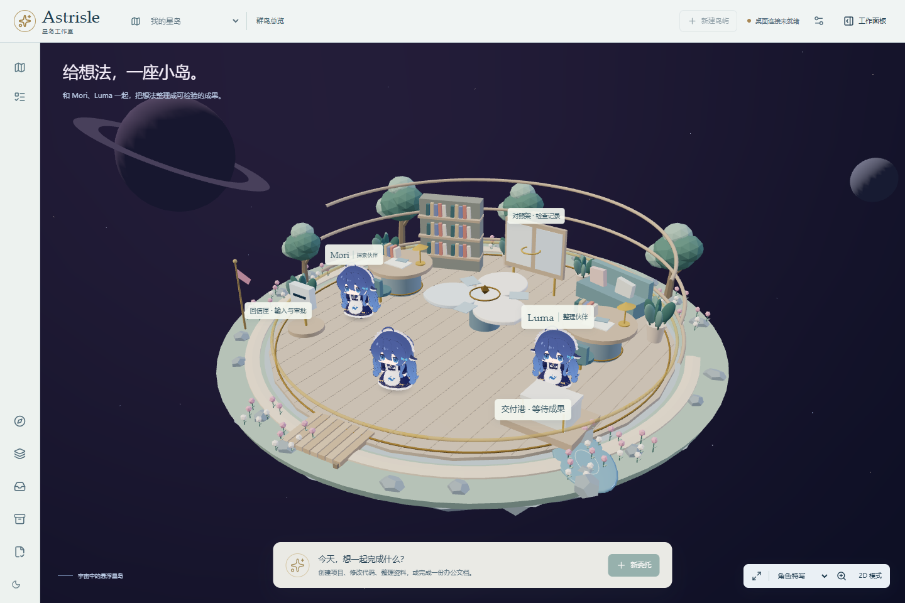

# Astrisle · 星岛工作室

把真实项目交给伙伴，在一座可以走进的工作室里观察、决策和验收。

Astrisle 是一个面向 Windows 的多 Agent 桌面工作台。目标是让伙伴从零创建项目、修改已有代码、处理办公资料，并通过自动分工、交接、复核与返工推进工作。3D 场景呈现协作关系，普通面板提供文件、证据、权限和进度的具体信息。

**当前状态：第三阶段开发预览。** 已支持宇宙浮岛场景、本地角色模型导入、伙伴显示名称修改，并降低持续渲染开销；尚未完成完整 v0.1 验收，也未用真实供应商凭据验收开放式项目任务。



## 当前实现

| 模块 | 当前内容 |
|---|---|
| 桌面 | Electron 窗口与托盘、受限 preload 桥接、独立 Node 运行时、系统加密的 API 密钥存储 |
| 工作空间 | 创建或导入项目、独立工作副本、文件基线、候选变更整合、冲突检查、导出到新目录 |
| 委托与协作 | SQLite 持久化、幂等派单、动态任务图、两位伙伴、版本化交接、复核与返工、持久化动作回执与重启续接 |
| 模型适配 | OpenAI-compatible Chat Completions、OpenAI Responses、Anthropic Messages、Gemini generateContent 四种协议 |
| 工作工具 | 文件检索/读取/写入/局部修改、明确授权的本机进程、按域名授权的网页读取 |
| 办公 | DOCX、XLSX、PPTX 常用创建与局部修改；文件回读、来源记录和独立数值检查 |
| 前端 | 宇宙中的悬浮工作室、群岛总览、岛屿创建/命名/切换、角色特写、按需渲染、2D 模式和减少动效 |
| 角色配置 | 外部 GLB／自包含 glTF 导入、自动居中与尺寸归一化、四方向调整、伙伴显示名称修改、跨岛屿保存与资源共享 |

模型适配器已有协议测试；这不代表所有厂商、模型和第三方兼容端点都已实测。DeepSeek、通义等服务应在符合工具调用协议时选用兼容模式，并填写该服务实际的基础地址与模型名称。

## 本地启动

当前开发和验证环境是 Windows x64、Node.js 22.22、Python 3.12 和 pnpm 11.21。Node 至少需要 22.13，以提供本项目使用的 `node:sqlite`；Node 22 下出现 SQLite experimental 提示是已知现象。

先准备 Node.js、Python、pnpm 和 Git，在 PowerShell 中执行：

```powershell
git clone https://github.com/orange11-forever/Astrisle.git
cd Astrisle

pnpm.cmd install --frozen-lockfile --ignore-scripts --store-dir .pnpm-store
node node_modules/esbuild/install.js
node node_modules/electron/install.js

python -m venv .venv
.venv\Scripts\python.exe -m pip install -r workers\office\requirements.txt

pnpm.cmd build
pnpm.cmd start
```

PowerShell 下使用 `.cmd`，避免系统禁用 `.ps1` 时无法启动 pnpm。依赖脚本在安装时关闭，再明确执行 esbuild 和 Electron 的安装器。Python 办公环境位于项目 `.venv`，不修改系统 Python 包。

Electron 下载较慢时，可仅在当前 PowerShell 会话设置镜像后重试安装器：

```powershell
$env:ELECTRON_MIRROR = 'https://npmmirror.com/mirrors/electron/'
node node_modules/electron/install.js
```

开发模式：

```powershell
pnpm.cmd dev
```

此命令构建桌面进程、启动 Vite 和 Electron。前端支持热更新；修改桌面或运行时代码后需重启开发命令。单独访问 Vite 页面只是浏览器预览，会明确显示“桌面连接未就绪”，不会获得本机工具权限。

## 开始工作

1. 在设置中选择 API 协议，填写基础地址、模型名称和密钥，保存并测试连接。密钥不应写进项目文件或聊天。
2. 创建并命名岛屿，或导入已有项目。**一座岛屿对应一个工作空间**；可从 3D 群岛总览切换进入不同岛屿。创建岛屿不需要模型密钥，导入产生独立副本，原项目不会因此被修改。
3. 创建委托，填写目标、验收要求和授权范围。默认不授予本机程序执行和网络访问。
4. 从伙伴、任务与证据面板查看实际执行，回复必要的问题；查看具体产物后可分项接受和导出。

在场景右下角选择“角色特写”，可旋转、缩放查看 Mori、Luma 和用户化身；“回到全景”恢复工作室视角。人物造型不决定实际使用的 API 或模型供应商。

在“工作室设置 → 角色外观与名称”中，可以修改每位角色的显示名称，导入或替换本地模型，并调整朝向。名称不改变内部任务身份或历史记录。模型会保存到应用自己的数据目录，原文件之后移动也不影响使用。

当前接受 100 MB、200 万三角面以内的 GLB 或自包含 glTF 2，贴图和缓冲区须内嵌；暂不支持 Draco、Meshopt、KTX2 等需要额外解码器的格式。带有动画的文件会使用已有剪辑；没有骨骼和动画的文件保留静态姿态，不自动生成动作。

相同模型只解析一次并共享几何、材质和贴图。默认环境动画最多请求 30 帧/秒；减少动作时，静止场景不持续绘制；失焦或隐藏时停止环境帧调度，交互和业务状态更新仍可请求刷新。受控后台测量的细节见[第三阶段记录](docs/development/stage-3.md)。

程序化默认角色仍保留在 `apps/client/src/characters/blue-whale-girl.ts` 作为未导入模型时的回退项；其导出命令为 `node scripts/export-character.mjs`。用户导入的文件不进入这个默认资产，也不会随源码仓库分发。

退出再打开应用后，运行时会读取已保存的动作记录和当前任务文件。尚未确认结果的写入保持待核查；保存明确的核查结论后才能继续，旧调用不会自动重放。普通输入或审批仍须单独回答。

**本机程序执行属于可信宿主模式，不是安全沙箱。** 允许后，程序可能访问宿主文件和网络；文件工具、网页工具的作用域不能限制任意子程序。当前版本只适合明确授权的可信项目。

关闭窗口会进入托盘，工作运行时继续存在；从托盘选择“退出 Astrisle”才执行关闭流程。开发数据位于 `.astrisle-dev/`，其中包括项目副本、SQLite 状态、产物、加密配置、`characters.json` 和 `character-assets/`，已从 Git 忽略。不要把该目录当成可随意删除的构建缓存。

## 验证

```powershell
pnpm.cmd typecheck
pnpm.cmd test
.venv\Scripts\python.exe -m pytest workers\office\tests -q --basetemp=workers\office\.test-tmp
pnpm.cmd build
pnpm.cmd test:ui
```

UI 测试当前使用 Microsoft Edge；桌面测试使用真实 Electron 和独立测试数据，验证工作区、角色配置、模型副本的持久化及渲染进程权限。测试结果见[第一阶段](docs/development/stage-1.md)、[第二阶段](docs/development/stage-2.md)和[第三阶段记录](docs/development/stage-3.md)。

运行时集成测试使用本地脚本化 HTTP 模型替身，文件和数据库操作是真实的。这类测试验证协议与状态转换，不能替代真实模型能力验收。

## 已知限制

- 原项目安全写回尚未完成，界面会返回不可用原因；当前使用新目录导出。没有验证 Windows 独占写入与中断恢复前不会开放写回。
- 尚未用真实模型 API 完成编程与办公全流程验收，无法据此承诺所有开放式委托都能成功。
- Office 验证目前覆盖结构回读和数值核对；没有完成 Microsoft Office/LibreOffice 打开、公式引擎重算及版式验收。复杂对象、宏和外部链接可能被拒绝。
- 当前任务隔离采用独立文件副本与基线清单，尚未采用内部 Git worktree。多进程租约、严格进程树隔离、完整恢复及长期资源控制仍需完善。
- 外部模型的外观和骨骼能力取决于文件本身；当前没有自动绑骨、动作生成或跨骨骼重定向。默认程序化角色和场景仍为开发资产。
- 3D 绘制开销已经降低，但短时后台测量不等于完整桌面性能验收；启动包体、长期内存与不同硬件仍需后续检查。
- 当前提供源码开发启动方式，尚无正式签名安装包、自动更新服务或公开发行验收。

完整目标和后续工作保留在设计、计划中；本阶段的运行截图与测试通过不表示全部目标已经实现。

## 工程结构

```text
apps/client/           React 面板、Three.js/R3F 场景和动作导演
apps/desktop/          Electron、凭据存储和进程桥接
packages/contracts/   共享接口
packages/runtime/     模型、任务循环、调度与控制
packages/domain/      任务图、依赖与版本规则
packages/persistence/ SQLite 状态、回执、事件与调用记录
packages/artifacts/   不可变产物与哈希核验
packages/executor/    文件、进程、网络和办公工具
packages/workspace/   副本、基线、整合与导出
workers/office/       Python 文档、表格和演示稿处理
tests/                集成与桌面端到端测试
docs/                 产品设计、概念图、计划和阶段记录
```

## 设计资料与开发流程

- [原始产品与技术设计](Astrisle-设计文档.md)
- [总体规划与系统设计](docs/superpowers/specs/2026-11-11-astrisle-system-design.md)
- [场景与角色动作设计](docs/superpowers/specs/2026-11-11-astrisle-spatial-design.md)
- [完整 v0.1 开发计划](docs/superpowers/plans/2026-11-11-astrisle-v0.1.md)
- [概念图生成说明](docs/concepts/astrisle-star-island-prompt.md)
- [鲸鱼角色参考、署名与使用条件](docs/concepts/blue-whale-girl-references.md)：角色视觉资产保留上游 CC BY-NC-SA 4.0 的署名、非商业与相同方式共享条件，具体范围见该文档。
- [今日收尾与下次交接](docs/development/stage-3.md)
- README Logo 沿用软件现有标志，内侧星形使用 Lucide Sparkles；[许可说明](docs/assets/LICENSE-lucide.txt)。

从 `main` 创建功能分支，在分支内实现、验证和提交，再推送并通过 PR 审查。第一阶段已合并；本轮在 `feat/runtime-continuity` 开发，阶段结果不自动合并或发布。
