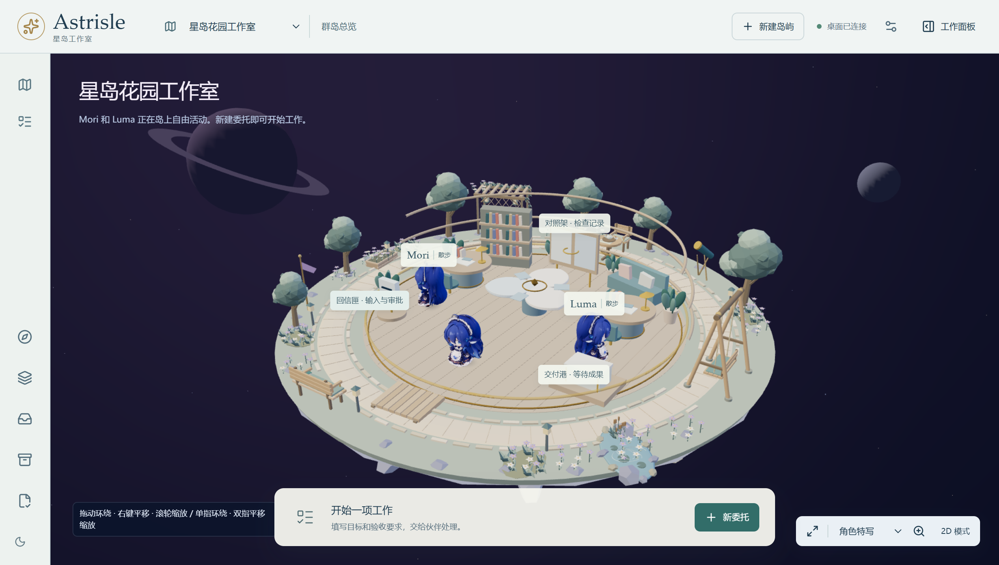

# 第八阶段：自由视角与自动岛屿生活

2026-11-14。本轮在功能分支 `feat/island-life-camera` 实现，基于 `main` 的 `1af8a48`。用户要求更自由的 360° 视角、丰富精细的场景，以及坐椅子、荡秋千、喝茶，并明确选择全部自动发生。

## 本轮内容

- 全景镜头移除水平角度限制，俯仰范围 0.1–1.5 弧度，缩放范围 3–70。支持地面平移，目标约束在半径 7 内；固定镜头同时禁止旋转、平移和缩放。复位和特写恢复明确目标，窗口变化保留用户视角。桌面和触屏提示在窄屏避开底部工作入口。
- 新增有靠背、坐垫、滚边和书本的花园长椅，木茶桌、桌旗、托盘、茶壶、杯碟和点心，以及木秋千、绳索、吊环和座板。人物与设施共用位置、朝向和座高；秋千座板与人物使用同一个摆动相位。
- 花园细化为花瓣、低矮叶丛、分枝树冠、路缘与铺装接缝、藤架格栅、攀缘植物、挂灯、芦苇和睡莲。静态园景仍合并成两个网格；交互家具增加五个合并网格，未增加独立点光源或环境动画循环。
- 三位角色依次经历散步、走近设施、落座、活动、起身。共享预订避免重叠，等待被占用的下一处设施以保证活动轮换。任务和真实交接优先；工作不受休闲状态影响。
- 隐藏或失焦时暂停活动时间。减少动效、特写、切岛和卸载会清理休闲状态／预订。标签显示当前活动，近景不再随镜头放大遮挡人物。

## 角色适配与审查修复

默认角色使用现有关节。支持的静态模型复用展示用骨骼，不修改导入文件、共享几何或贴图。杯柄跟随实际变形后的手部网格；有可用外观线索时，用下部手部位置校正短身角色比例，找不到线索时保留保守几何推断。

独立审查指出，直接把杯子挂在推断骨骼上会与仅部分受骨骼影响的手部网格分离。新增几何采样和世界坐标接触测试后修复。实际本机模型检查另外发现长裙穿座板：现在依据衣裙接触高度落座，并限制裙装手势变形。对这个未带骨骼的模型，端杯与落座仍是保守展示姿态，不是专业重定向或布料模拟。

浏览器验收还复现并修复了运行中系统减少动效偏好不更新，以及繁忙设施可能被长期跳过的问题。园景的设施避让范围改为从共享设施位置派生。

## 本次验证

| 检查 | 结果 |
|---|---|
| `pnpm.cmd test` | 27 个文件，189 项通过 |
| `pnpm.cmd test:office` | 10 项通过 |
| `pnpm.cmd test:ui` | 20 项通过，约 1.3 分钟 |
| `pnpm.cmd build` | 类型检查、Vite 与桌面构建通过 |
| `pnpm.cmd format:check`、`git diff --check` | 通过 |
| Impeccable detector | 一次检查，返回空发现列表 |

镜头测试使用真实鼠标拖动、滚轮和右键平移，覆盖后方视角、俯仰、边界、锁定、复位、窗口变化及窄屏提示。休闲测试推进实际挂载的帧回调，验证活动轮换、杯柄接触、秋千同步、任务打断、导入模型和特写；没有在产品代码中加入测试专用加速入口。纯状态机测试覆盖完整周期、预订争用、后台暂停和减少动效，几何测试覆盖衣裙接触及原姿态恢复。

检查了默认模型和当前本机静态模型的全景／侧面落座、端杯和秋千画面。默认预览约 25.7 万三角面、476 次绘制；三位本机模型共享资源的预览约 157.6 万三角面、227 次绘制。这是短时场景计数，不是长期性能或低配置硬件验收。环境仍保留 30 fps 请求上限、按需渲染和画布像素预算。

本机模型只读用于隔离预览。按用户后续要求，README 与本记录改用当前角色的真实 Electron 构建截图：在独立数据目录创建展示工作空间，核对三位角色的模型与朝向均与当前配置一致，拍摄全景、特写和环绕视角后正常关闭并清理该隔离目录。截图进入文档，模型文件、原始设置和工作数据不随源码分发；拍摄前后原角色配置一致，页面异常为零。

开发模式的导入占位标签卸载仍可出现 React 嵌套 root 提示；本次未观察到页面异常或场景失效。构建保留已有的大 chunk 提示。

## 仍保留的边界

- 无法适配的静态模型、原生骨骼或动画模型继续使用原有显示／剪辑；不强行套用休闲姿态。任意体型、复杂袖摆和材质不保证自动手部识别或无穿插。
- 没有新增手动动作菜单、物理模拟、真实模型供应商验收或任务后端行为。本轮不改变项目数据和权限。
- 原有 v0.1 未完成项继续保留：安全写回、真实模型开放任务、Office 实际应用验收、完整恢复、长期资源控制及正式安装包等。

设计：[自由视角与岛屿生活](../superpowers/specs/2026-11-14-island-leisure-camera-design.md)。计划：[实现步骤](../superpowers/plans/2026-11-14-island-leisure-camera.md)。
