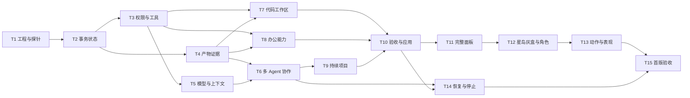

# Astrisle v0.1 Implementation Plan

> **For agentic workers:** REQUIRED SUB-SKILL: Use superpowers:subagent-driven-development (recommended) or superpowers:executing-plans to implement this plan task-by-task. Steps use checkbox (`- [ ]`) syntax for tracking.

**Goal:** 交付一个 Windows 多 Agent 工作室，能够从零创建项目、修改已有项目、独立完成办公任务，并在有创意的 3D 空间中持续推进和交付可核查成果。

**Architecture:** React 面板与 Three.js 场景消费同一份业务快照。独立 TypeScript Runtime 负责动态计划、双 Agent 调度、事务状态与恢复；受控工具执行器负责代码、文件、办公和联网工具。状态保存在 SQLite，产物按不可变版本落盘，接受与写回分离。

**Tech Stack:** 建议 Electron、TypeScript、React、Three.js / R3F、SQLite、Python 办公 worker、Vitest、pytest、Playwright；完整版本由 Task 1 的兼容性探针锁定。

**Spec:** [总体设计](../specs/2026-11-11-astrisle-system-design.md)、[空间与动作设计](../specs/2026-11-11-astrisle-spatial-design.md)、[原始文档](../../../Astrisle-设计文档.md)。三份一起阅读；用户本轮对开放式任务能力和空间创意的补充优先于原稿中的演示建议。

**Status:** 仅规划，所有复选框均未完成。当前没有应用代码、依赖锁、测试或三维资产。下列路径是拟建路径，命令是未来验收命令，不是本轮已运行记录。

## Global Constraints

- Windows 桌面首发；延续 Three.js 方向；AI 执行独立于 3D。
- 多 Agent 协作和办公能力都属于首版；不能以单个修复或固定演示代替整个首版。
- 新项目、已有项目和办公任务共用通用运行时，禁止按演示名称硬编码任务图。
- 每位伙伴同一时间最多一个执行任务，初始总并发建议为 2。
- 同一工作区最多一个活动的可写委托，后续委托可存草稿；写回另取工作区写锁。
- 单次瞬时错误最多重试 2 次；连续语义返工建议最多 3 轮后请求具体决定；限额可配置。
- 接受交付与应用到原项目分离；缺少证据不能写成通过；旧失败记录不能被新版本覆盖。
- Renderer 不执行任意宿主命令；工具权限独立检查；旧授权不自动跨委托继承。
- 真实工具运行与动画独立；重复事件、无 3D、站位占满均不改变业务执行次数。
- 文档中的技术选型和美术方向是本次建议；用户已确认的是目标与约束。

## Review Focus

- 丢失回执/崩溃后的非幂等操作：先核查后恢复，不重复应用或发布。（Task 2、14）
- 返工、需求变更后的证据：只认最终候选版本，避免旧通过状态继续放行。（Task 4、6、9）
- 原项目存在未提交文件、外部同时写入或 Windows junction：保护真实基线，拒绝不安全写回。（Task 3、7、10）
- 复杂 Office 对象、未重算公式、缺少目标应用：不把解析成功当作格式保真/实测通过。（Task 8）
- 场景积压事件、切换项目与中断动作：不重复演出、不串项目、不阻塞用户点击。（Task 12、13）

---

## 1. 文件结构与职责

```text
apps/
  desktop/                 Electron 主进程、preload、托盘、凭据与打包
  client/                  React 面板、场景、客户端快照投影
packages/
  contracts/               命令、事件、工具及模型边界的 schema 与类型
  domain/                  委托、任务、复核、验收与版本失效规则
  persistence/             SQLite schema、迁移、事务、回执、事件
  runtime/                 Agent 循环、计划校验、调度、上下文与恢复
  executor/                权限、文件/进程工具、worker 生命周期
  workspace/               导入、新建、基线、Git 副本、集成、应用
  artifacts/               不可变文件、哈希、来源与版本检查
workers/
  office/                  Python 文件创建/修改、核算与预览
  winfs/                   Windows 独占写入与应用日志辅助程序
tests/
  fixtures/                小型代码/办公/故障样例，不进入生产计划逻辑
  integration/             真实文件系统、SQLite、进程协作
  e2e/                     桌面面板与场景端到端
  acceptance/              不同委托的正式验收与真实模型试跑
docs/
  superpowers/             本次设计和计划
  concepts/                概念图、灰盒分镜、资产清单
  validation/              后续逐阶段真实记录
```

按业务职责拆包，不为每个小工具创建微服务。共享 schema 是进程边界；React 组件与 Python worker 都不能绕过 Runtime 修改业务状态。

## 2. 公共接口约定

以下命名用于任务间对接，Task 1～2 将其固化到 `packages/contracts/src/`。所有 ID 为不透明字符串，时间使用 UTC ISO 8601；哈希使用 SHA-256；文件访问引用逻辑根目录 ID 与相对路径，不接受 Renderer 任意绝对路径。

| 类型 | 必须固定的字段/含义 |
|---|---|
| `CommissionDraft` | `workspaceId, goal, deliverables, criteria, scope, budget, planningMode`；`planningMode` 为 `auto` 或 `review_first` |
| `PlanProposal` | `revision, tasks, dependencies, coverage, rationaleSummary`；`coverage` 关联每条验收条件 |
| `TaskSpec` | `id, agentId, goal, inputs, outputs, criteriaIds, reviewPolicy` |
| `DependencySpec` | `fromTaskId, toTaskId, kind, outputKey?`；`kind` 为 `artifact_available` 或 `task_passed` |
| `ArtifactRef` | `artifactId, versionId, sha256, mediaType` |
| `ToolInvocation` | `callId, runId, toolName, toolVersion, args, grantId, deadline, runtimeEpoch` |
| `ToolObservation` | `callId, status, evidence, artifacts, sideEffectReceipt, usage`；工具失败与质量失败分离 |
| `ReviewDecision` | `targetVersionIds, verdict, findings, evidenceIds`；结论为 `passed / changes_requested / unable_to_verify` |
| `ProjectSnapshot` | `workspaceId, commissionId, revision, lastSequence, requirements, tasks, runs, artifacts, findings, requests, acceptance, control` |
| `CommandReceipt` | `requestId, status, result, committedRevision`；同编号不同内容为冲突 |
| `ApplyPlan` | `operationId, workspaceId, baseManifestId, candidateManifestId, changes, expectedRevision` |

错误必须有可机读的 `code`、面向用户的说明和受影响 ID。流程使用结果联合类型表示拒绝、冲突、缺能力、结果未知，不能靠解析模型自然语言决定状态。

## 3. 依赖与里程碑



M0 = T1 与空间分镜；M1 = T2～6；M2 = T7～11；M3 = T12～13；M4 = T14～15。恢复规则从 T2 开始实现，T14 是集中故障验证与补全，不是把可靠性全部留到最后。

具体排期在 M0 后按实际投入评估。可拆为运行时/工具、客户端/3D 两条人员工作线，但共享 schema 与接口变更必须协调。美术可在 M0 后制作核心资产，不必等 T12 才开始；业务接入仍按依赖推进。

## Task 1：工程骨架与高风险兼容性探针

**Files**

- Create: `package.json`, `pnpm-workspace.yaml`, `tsconfig.base.json`, `vitest.config.ts`, `playwright.config.ts`
- Create: `apps/desktop/src/main.ts`, `apps/desktop/src/preload.ts`, `apps/client/src/main.tsx`
- Create: `packages/contracts/src/index.ts`, `packages/runtime/src/main.ts`
- Create: `workers/office/pyproject.toml`, `docs/validation/m0-feasibility.md`, `docs/validation/provider-profile.json`
- Test: `tests/integration/runtime-smoke.test.ts`

**Interfaces:** `startRuntime(options: RuntimeOptions): Promise<RuntimeHandle>`，`RuntimeHandle` 提供 `health()` 和 `stop()`；`RuntimeOptions` 包含数据根目录与测试/生产配置。

- [ ] 建立最小桌面壳、独立 Runtime 与办公 worker 环境；所有版本锁定并记录，不改原设计文件。
- [ ] 写测试 `runtime_survives_renderer_reload`：重载 Renderer 后 Runtime 实例 ID 不变、SQLite 探针记录仍可读；初始应因缺少生命周期实现失败。
- [ ] 完成子进程握手和受限 preload 桥接，使测试通过。
- [ ] 进行模型工具调用、Python 打包、DOCX/XLSX/PPTX 转换、Windows 独占文件访问四项探针。模型只用测试资料；记录一个真实可用服务的 API 方言、SDK/端点和能力字段到 profile，密钥不入文件。T5 以该 profile 实现第一种适配器。
- [ ] 记录办公验收应用及版本、Windows 目标机器、执行信任模式；若未提供可用模型配置，仍完成不依赖它的探针，但不宣称真实模型已通过。
- [ ] Run: `pnpm exec vitest run tests/integration/runtime-smoke.test.ts`；预期通过。保存探针原始结果与限制，提交这个可启动的最小工程。

**交付：** 能启动、重载、关闭的壳与 Runtime；具体技术依赖可用性有证据，空间五幕分镜有明确文档。

## Task 2：委托状态、持久事务与幂等回执

**Files**

- Create: `packages/contracts/src/commands.ts`, `events.ts`, `snapshots.ts`, `schemas.ts`
- Create: `packages/domain/src/commission.ts`, `task.ts`, `errors.ts`
- Create: `packages/persistence/src/migrations/001_initial.sql`, `store.ts`, `receipts.ts`, `events.ts`
- Create: `packages/runtime/src/command-router.ts`, `queries.ts`
- Test: `tests/integration/command-idempotency.test.ts`, `snapshot-events.test.ts`

**Interfaces:** `dispatch(command: CommandEnvelope<RuntimeCommand>): Promise<CommandReceipt>`；`getSnapshot(commissionId: string): Promise<ProjectSnapshot>`；`getEvents(commissionId: string, afterSequence: number): Promise<EventEnvelope<DomainEvent>[]>`。`RuntimeCommand` 使用可辨识联合类型，每新增命令同步加 schema。

- [ ] 写 `duplicate_submit_returns_original_commission`、`same_request_different_body_conflicts`、`commit_updates_state_and_event_together`；断言重复提交只一条委托、序号无重复、回执包含同一结果。
- [ ] 运行上述两份测试，确认缺少实现而失败。
- [ ] 实现单写入事务、schema 迁移、回执唯一约束、需求版本和事件队列；快照与游标在一致读取中取得。
- [ ] 补充 `stale_expected_revision_does_not_overwrite` 与 `event_gap_requires_snapshot`，断言旧修订命令拒绝且客户端不越过缺失序号。
- [ ] 补充 `one_writable_commission_per_workspace`：第二个写委托保留草稿；首个暂停时不能抢占，首个完成/停止且写进程已退出后才可受理；写回与活动写委托互斥。
- [ ] Run: `pnpm exec vitest run tests/integration/command-idempotency.test.ts tests/integration/snapshot-events.test.ts`；预期全部通过，提交。

**交付：** 无模型也能受理/查询委托，重启可恢复，重复请求不会重复创建。

## Task 3：权限与通用执行器

**Files**

- Create: `packages/contracts/src/tools.ts`, `grants.ts`
- Create: `packages/executor/src/policy.ts`, `path-guard.ts`, `tool-registry.ts`, `executor.ts`, `process-supervisor.ts`
- Create: `packages/executor/src/tools/files.ts`, `process.ts`, `web.ts`
- Test: `tests/integration/executor-policy.test.ts`, `process-stop.test.ts`

**Interfaces:** `authorize(invocation: ToolInvocation, grant: Grant): AuthorizationDecision`；`execute(invocation: ToolInvocation, signal: AbortSignal): Promise<ToolObservation>`；`stop(callId: string): Promise<StopReceipt>`。`Grant` 明确根目录、程序/参数、网络、有效期和撤销版本。

- [ ] 写测试覆盖授权根内操作、`..`、大小写绕过、junction、跨项目、已撤销权限和网络重定向；断言越界写入未发生，拒绝原因可定位。
- [ ] 运行失败测试；实现规范化、工具 schema 校验、运行前再次授权、最小环境变量和进程日志。
- [ ] 实现读写/搜索、目录创建、结构化进程运行和授权网页读取，返回实际结果与调用 ID。安装依赖也是明确工具操作，不能隐藏在文件读取内。
- [ ] 写 `stop_waits_for_process_tree_confirmation`：停止请求后有子进程存活时不返回已停止；接入 Windows 进程组/Job 管理并验证。
- [ ] Run: `pnpm exec vitest run tests/integration/executor-policy.test.ts tests/integration/process-stop.test.ts`；预期通过，提交并记录可信宿主模式与隔离模式的能力区别。

**交付：** 通用工具可执行且权限可验证；已获授权的普通步骤无需反复审批。

## Task 4：不可变产物、来源与证据

**Files**

- Create: `packages/contracts/src/artifacts.ts`, `evidence.ts`
- Create: `packages/artifacts/src/store.ts`, `integrity.ts`
- Create: `packages/domain/src/lineage.ts`, `evidence-validity.ts`
- Create: `packages/runtime/src/artifact-service.ts`
- Test: `tests/integration/artifact-publication.test.ts`, `lineage-invalidation.test.ts`

**Interfaces:** `publishArtifact(input: PublishArtifactInput): Promise<ArtifactRef>`，输入包括生成调用、临时文件与确定输入版本；`verifyArtifact(ref: ArtifactRef): Promise<IntegrityResult>`；`findAffectedVersions(replacedVersionId: string): Promise<string[]>`。

- [ ] 写测试 `no_event_before_readable_blob`、`disk_full_keeps_previous_version`、`corruption_invalidates_evidence`；初始运行确认失败。
- [ ] 实现临时文件、哈希、不可变存储、事务登记和事件发布；业务事务前失败产生的孤儿文件可核查，不自动成为成果。
- [ ] 写 `replacement_invalidates_only_dependent_outputs`：A2 替代 A1 后，依赖 A1 的 B1 和检查过期，独立 C1 保持有效，A1 历史记录仍在。
- [ ] 实现来源链及检查版本绑定，所有“通过”引用 evidence ID 和最终版本。
- [ ] Run: `pnpm exec vitest run tests/integration/artifact-publication.test.ts tests/integration/lineage-invalidation.test.ts`；预期通过，提交。

**交付：** 工具输出可以成为可验证产物，版本变更不会继承旧证据。

## Task 5：模型适配、Agent 工具循环与上下文

**Files**

- Create: `packages/contracts/src/model.ts`, `plans.ts`, `context.ts`
- Create: `packages/runtime/src/providers/provider.ts`, `configured-provider.ts`
- Create: `packages/runtime/src/agents/agent-loop.ts`, `plan-validator.ts`, `context-builder.ts`, `prompts.ts`
- Create: `apps/desktop/src/credentials.ts`
- Test: `tests/integration/agent-loop.test.ts`, `plan-validation.test.ts`

**Interfaces:** `ProviderAdapter.nextTurn(request: ModelTurnRequest, signal: AbortSignal): Promise<ModelTurnResult>`；结果为工具请求、计划提案、输入请求或候选交付。`runAgentTurn(runId: string, signal: AbortSignal): Promise<AgentTurnOutcome>`；`validatePlan(proposal: PlanProposal, snapshot: ProjectSnapshot): PlanValidation`。

- [ ] 写 `tool_result_drives_next_step`、`model_cannot_self_grant`、`cyclic_or_uncovered_plan_rejected`、`unknown_tool_is_not_executed`；使用可控模型替身断言调用序列与状态，不固定某业务模板。
- [ ] 运行失败测试；实现结构化输出校验、模型适配、按任务构建上下文及工具结果回传。
- [ ] 使用 T1 已验证的具体 provider profile 实现第一种实际适配器；能力不足或响应不合法时返回明确错误，不能把自然语言当工具 JSON。
- [ ] 增加密钥脱敏、调用用量、上下文压缩检查点与有限重试；工具原始输出仅按授权范围送模型。
- [ ] Run: `pnpm exec vitest run tests/integration/agent-loop.test.ts tests/integration/plan-validation.test.ts`；预期通过。另用测试资料完成真实模型一轮“读文件—修改副本—回读”，记录其实际结果后提交。

**交付：** 能依据目标和工具结果连续工作，能动态提出不同计划；不是文本模拟的伙伴。

## Task 6：双 Agent 调度、交接、复核与返工

**Files**

- Create: `packages/domain/src/dependencies.ts`, `reviews.ts`, `budgets.ts`
- Create: `packages/runtime/src/scheduler.ts`, `handoffs.ts`, `review-service.ts`, `rework-service.ts`, `leases.ts`
- Test: `tests/integration/multi-agent-flow.test.ts`, `review-rework.test.ts`

**Interfaces:** `dispatchReadyTasks(commissionId: string): Promise<string[]>` 返回新 run ID；`submitHandoff(input: HandoffInput): Promise<string>`；`submitReview(input: ReviewInput): Promise<ReviewDecision>`；`createRework(findingId: string): Promise<TaskSpec>`。

- [ ] 写 `two_ready_tasks_use_two_agents`、`one_agent_has_one_active_run`、`review_consumes_candidate_before_producer_passes`，断言真实任务依赖不会形成复核死锁。
- [ ] 运行失败测试；实现租约、并发 2、两种依赖、输入版本固定和控制消息优先级。
- [ ] 写 `finding_returns_to_owner_and_preserves_failed_version`、`third_rework_limit_requires_decision`：复核问题自动到负责人，旧失败保留，超限后不自转。
- [ ] 实现独立作者/复核者校验、返工版本与分支级阻塞；一条拒绝扩权不阻塞无关分支。
- [ ] Run: `pnpm exec vitest run tests/integration/multi-agent-flow.test.ts tests/integration/review-rework.test.ts`；预期通过，提交。

**交付：** 至少两位伙伴能并行准备、自动交接、复核返工，用户不用传话。

## Task 7：创建、接手和整合代码项目

**Files**

- Create: `packages/workspace/src/baseline.ts`, `import.ts`, `create.ts`, `task-copy.ts`, `integrate.ts`
- Create: `packages/executor/src/tools/code.ts`
- Create: `tests/fixtures/code-existing/`, `tests/fixtures/code-empty/`
- Test: `tests/integration/code-workspace.test.ts`, `candidate-integration.test.ts`

**Interfaces:** `createWorkspace(input: NewWorkspaceInput): Promise<WorkspaceRef>`；`importWorkspace(input: ImportWorkspaceInput): Promise<BaselineManifest>`；`createTaskCopy(taskId: string, baseManifestId: string): Promise<WorkCopyRef>`；`integrateCandidates(input: IntegrationInput): Promise<IntegrationResult>`。

- [ ] 写 `import_includes_authorized_dirty_files`、`import_does_not_mutate_original_git_metadata`、`new_workspace_does_not_require_existing_repo`，记录原目录哈希和 Git 元数据前后相同。
- [ ] 运行失败测试；实现文件清单基线、独立管理副本、内部工作树、可配置构建/检查入口。
- [ ] 写 `individually_passing_branches_require_integration_check` 与 `conflict_creates_owned_task`；断言集成结果另有证据，冲突不会静默选一边。
- [ ] 接入通用 Agent，使其在两份不同测试项目中分别从零创建和修改现有功能；项目技术按任务目标决定。
- [ ] Run: `pnpm exec vitest run tests/integration/code-workspace.test.ts tests/integration/candidate-integration.test.ts`；预期通过，提交并保存可复现构建记录。

**交付：** 新建与跨文件改动都可完成，原目录保持可保护基线。

## Task 8：办公创建、修改、核验与预览

**Files**

- Create: `workers/office/astrisle_office/protocol.py`, `inspect.py`, `documents.py`, `workbooks.py`, `presentations.py`, `render.py`, `verify.py`
- Create: `packages/executor/src/tools/office.ts`, `packages/contracts/src/office.ts`
- Create: `workers/office/tests/test_roundtrip.py`, `test_integrity.py`, `test_render_evidence.py`
- Create: `tests/fixtures/office/`，包括创建目标、普通修改模板和含不支持对象的样例

**Interfaces:** `officeInvoke(request: OfficeRequest, signal: AbortSignal): Promise<OfficeResult>`；请求包含 `schemaVersion, operation, inputVersionIds, operations, outputDirectory, verificationProfile`。Python `handle(request: dict) -> dict` 返回文件、变更清单、来源映射和验证结果；复杂编辑脚本仍通过获准进程工具执行，不能绕开产物登记。

- [ ] 写 `test_create_and_edit_all_three_formats`：DOCX 段落表格、XLSX 单元格/公式/样式、PPTX 文字/图表各有新建与局部修改案例，保留范围外内容。
- [ ] 运行失败测试；实现协议与常用编辑；所有输出是新版本，原输入不可覆盖。
- [ ] 写 `test_unsupported_objects_are_reported`、`test_formula_text_is_not_recalculation`、`test_source_rows_survive_summary`：核对源行、公式重算来源与复杂对象处理。
- [ ] 接入可用转换器，渲染 DOCX/PPTX 页面与工作表预览；检查溢出、遮挡和数据错误。转换器缺失时显示 `unable_to_verify`，不能伪造截图或 Office 打开记录。
- [ ] Run: `python -m pytest workers/office/tests -q`（在 T1 建立的办公环境中）；预期通过。分别用已记录的实际验收应用打开产物，保存应用名/版本和检查结果后提交。

**交付：** 办公能独立形成成果，新建与修改都覆盖；不仅是代码项目附带一页说明。

## Task 9：需求修订、长期项目与继续工作

**Files**

- Create: `packages/domain/src/requirements.ts`, `decisions.ts`
- Create: `packages/runtime/src/requirement-service.ts`, `project-context.ts`, `resume-service.ts`
- Test: `tests/integration/requirements-change.test.ts`, `project-continuity.test.ts`

**Interfaces:** `reviseRequirements(input: RequirementChangeInput): Promise<RequirementRevision>`；`resumeCommission(commissionId: string): Promise<ResumeReport>`；`buildProjectContext(workspaceId: string, scope: Grant): Promise<ProjectContext>`。

- [ ] 写 `new_goal_changes_plan_and_deliverables`、`unaffected_accepted_output_remains_available`、`new_commission_does_not_inherit_grants`。
- [ ] 运行失败测试；实现影响分析、需求修订、任务图修订及来源明确的决定记录。
- [ ] 写 `changed_file_invalidates_summary`、`restart_rebuilds_context_without_full_chat`；重新读取实际文件，不能把旧摘要当最新事实。
- [ ] 接入书架的显式保存/引用接口；用户未选择保存的偏好不提升为全局规则。
- [ ] Run: `pnpm exec vitest run tests/integration/requirements-change.test.ts tests/integration/project-continuity.test.ts`；预期通过，提交。

**交付：** 项目可以持续推进，新增要求确实改变工作，旧上下文和授权不会失控继承。

## Task 10：分项验收与安全写回

**Files**

- Create: `packages/domain/src/acceptance.ts`
- Create: `packages/runtime/src/acceptance-service.ts`
- Create: `packages/workspace/src/apply-plan.ts`, `apply.ts`, `apply-recovery.ts`
- Create: `workers/winfs/Astrisle.WinFs.csproj`, `Program.cs`, `LockedApply.cs`（小型 Windows 辅助程序，具体运行时版本由 T1 验证）
- Test: `tests/integration/acceptance.test.ts`, `safe-apply.test.ts`

**Interfaces:** `evaluateAcceptance(commissionId: string): Promise<AcceptanceReport>`；`acceptDeliverables(input: AcceptanceInput): Promise<AcceptanceRecord>`；`prepareApply(input: PrepareApplyInput): Promise<ApplyPlan>`；`applyCandidate(plan: ApplyPlan, grant: Grant): Promise<ApplyResult>`。

- [ ] 写 `acceptance_requires_current_evidence`、`partial_acceptance_does_not_apply_files`、`missing_validation_cannot_become_complete`。
- [ ] 运行失败测试；实现验收条件到最终版本/证据的逐条映射、分项接受与独立导出。
- [ ] 写 `concurrent_external_edit_is_preserved`、`create_is_exclusive`、`interrupted_apply_reports_actual_files`；用两个真实进程制造竞态，不只模拟哈希变化。
- [ ] 实现锁内重检、排他创建、逐文件日志、备份和中断核查；路径无法可靠锁定时返回冲突或不支持。安全写回开关仅在这些测试通过后启用。
- [ ] Run: `pnpm exec vitest run tests/integration/acceptance.test.ts tests/integration/safe-apply.test.ts`；预期通过。核对恢复不会覆盖中断后的用户修改，提交。

**交付：** 用户可验收、导出和按授权应用完整项目改动，写回不会静默覆盖更新。

## Task 11：完整的普通工作面板

**Files**

- Create: `apps/client/src/state/project-store.ts`, `command-client.ts`
- Create: `apps/client/src/features/commission/CommissionEditor.tsx`, `project/ProjectOverview.tsx`, `tasks/TaskInspector.tsx`
- Create: `apps/client/src/features/requests/RequestPanel.tsx`, `delivery/DeliveryPanel.tsx`, `delivery/EvidenceViewer.tsx`, `settings/SettingsPanel.tsx`
- Modify: `apps/desktop/src/preload.ts`
- Test: `tests/e2e/panel-workflow.spec.ts`, `tests/e2e/connection-loss.spec.ts`

**Interfaces:** `useProjectSnapshot(commissionId: string): ProjectSnapshotState`；`sendCommand(command): Promise<CommandReceipt>`；统一选择状态 `Selection = { commissionId, taskId?, artifactVersionId?, findingId? }`，场景稍后复用。

- [ ] 写端到端测试：新建委托、查看真实执行、回答问题、拒绝一次扩权、查看部分成果、分项验收、单独申请写回。
- [ ] 运行失败测试；实现上述面板及 keyboard/focus 路径，信息先展示结果和缺口，再展开差异、测试、日志。
- [ ] 写 `lost_submit_receipt_uses_same_request` 与 `offline_does_not_claim_running_or_finished`；断言最后确认时间、原请求查询和重连恢复正确。
- [ ] 提供 `auto / review_first` 计划模式；默认自动推进已有授权工作，可选先审计划；审批与普通输入使用不同按钮和后果说明。
- [ ] Run: `pnpm exec playwright test tests/e2e/panel-workflow.spec.ts tests/e2e/connection-loss.spec.ts`；预期通过，提交。

**交付：** 关闭 3D 时也能完成全部核心工作，用户能查清每一个完成声明。

## Task 12：星岛布局、角色与灰盒交互

**Files**

- Create: `apps/client/src/scene/Studio.tsx`, `layout.ts`, `anchors.ts`, `camera.ts`, `navigation.ts`
- Create: `apps/client/src/scene/objects/StarTable.tsx`, `CompareRack.tsx`, `DeliveryDock.tsx`, `ReplyBox.tsx`
- Create: `apps/client/src/scene/avatars/Avatar.tsx`, `rig-profile.ts`
- Create: `docs/concepts/asset-manifest.json`
- Test: `tests/e2e/studio-interaction.spec.ts`

**Interfaces:** `Studio({snapshot, selection, onSelect, preferences})`；`resolveAnchor(anchorId: string): SceneAnchor`；`requestVisualPath(actorId: string, targetAnchorId: string): PathResult`。物件只发出统一 Selection，不另写业务状态。

- [ ] 按空间设计建立单层环形灰盒和三个角色；镜头能看见两工位、星图桌、交付港。
- [ ] 写可访问性/交互测试：任何热点可直接开面板，不必先移动；全景复位、键盘选择和遮挡处理可用。
- [ ] 引入许可明确的基础骨架和核心家具，记录来源、授权、三角形/纹理预算及动作映射；角色身份与模型资源分离。
- [ ] 人工走查入口、环路、占位和镜头，保存截图；依据实际测量修正空间，不把建议坐标当成不能调整的约束。
- [ ] Run: `pnpm exec playwright test tests/e2e/studio-interaction.spec.ts`；预期通过，提交。

**交付：** 有鲜明轮廓且能直接操作的星岛工作室；不是静态概念图。

## Task 13：动作导演、道具与生活感

**Files**

- Create: `apps/client/src/scene/director/scene-intent.ts`, `event-mapper.ts`, `director.ts`, `prop-state.ts`, `station-leases.ts`
- Create: `apps/client/src/scene/avatars/animation-controller.ts`, `personality-profile.ts`
- Create: `apps/client/src/scene/ambient/environment.ts`, `audio.ts`
- Test: `apps/client/src/scene/director/director.test.ts`, `tests/e2e/scene-business-parity.spec.ts`

**Interfaces:** `mapEventToIntent(event, snapshot): SceneIntent[]`；`director.accept(intent: SceneIntent): void`；`director.rebuild(snapshot: ProjectSnapshot): void`；`director.dispose(): void`。输出禁止包含业务写命令。

- [ ] 写 `duplicate_event_plays_once`、`obsolete_handoff_is_skipped`、`switch_project_clears_props`、`occupied_station_falls_back_after_1500ms`。
- [ ] 实现五个标志时刻：星图展开、折页递件、双页透镜、折返便签、交付靠港；先用基础动作拼接，再替换精细资产。
- [ ] 增加两位伙伴不同的阅读、标注、等待习惯；添加低频生活动作；持物/占位必须有中断清理。
- [ ] 写 `same_commission_same_tool_calls_with_scene_disabled`；减少动效、跳过动画、站位满和 WebGL 失败时，产物哈希与工具执行次数一致。
- [ ] Run: `pnpm exec vitest run apps/client/src/scene/director/director.test.ts` 及 `pnpm exec playwright test tests/e2e/scene-business-parity.spec.ts`；预期通过，提交并记录表现走查结果。

**交付：** 角色有个性，动作反映真实协作；空间表现不控制任务成败。

## Task 14：崩溃恢复、暂停、取消与资源控制

**Files**

- Create: `packages/runtime/src/recovery.ts`, `reconcile.ts`, `control-service.ts`, `budget-service.ts`
- Modify: `packages/runtime/src/leases.ts`, `packages/executor/src/process-supervisor.ts`, `apps/desktop/src/main.ts`
- Test: `tests/integration/crash-recovery.test.ts`, `cancel-and-budget.test.ts`

**Interfaces:** `recoverRuntime(): Promise<RecoveryReport>`；`reconcileCall(callId: string): Promise<ReconcileResult>`；`controlCommission(input: ControlInput): Promise<ControlReceipt>`。控制动作包括 pause/resume/cancel；预算耗尽设置暂停原因，不自动结束委托。

- [ ] 在工具启动前、文件已写未登记、事务已提交未发事件、写回部分完成四个位置注入进程崩溃，断言状态与物理结果可核查。
- [ ] 实现运行代次、租约与旧 worker 拒收；旧进程未确认停止时禁止再次派发同一写任务。
- [ ] 写 `unknown_external_effect_is_not_retried`、`cancel_not_final_until_confirmed`、`budget_pause_can_resume_from_checkpoint`；恢复不会制造第二份外部结果。
- [ ] 实现托盘后台、显式退出、工作检查点、日志轮转与可配置限额；无价格表时费用显示未知。
- [ ] Run: `pnpm exec vitest run tests/integration/crash-recovery.test.ts tests/integration/cancel-and-budget.test.ts`；预期通过，提交并保存故障矩阵结果。

**交付：** 长任务可控、可停、可恢复，取消与断线不制造虚假的完成或回滚。

## Task 15：跨任务正式验收与 Windows 发行候选

**Files**

- Create: `tests/acceptance/scenarios.ts`, `live-model-runner.ts`, `evidence-report.ts`
- Create: `apps/desktop/forge.config.ts`, `docs/validation/v0.1-acceptance.md`, `docs/validation/windows-performance.md`
- Create: `docs/user/quickstart.md`, `docs/user/capabilities-and-limits.md`

**Interfaces:** `runAcceptanceScenario(scenario: AcceptanceScenario): Promise<AcceptanceRun>`；记录目标、输入哈希、模型配置、真实任务图、调用、产物、检查和介入次数。

- [ ] 使用同一版本分别完成从零创建、接手修改、办公创建/修改、连续项目四组委托；每组至少观察两次真实模型运行，记录成功和失败，不隐藏失败样本。
- [ ] 增加一项开发期间未使用的委托；允许重新规划和返工，但不允许临时写业务专用调度分支来“通过”验收。
- [ ] 对照总体设计 A1～A11 逐项附证据；有关键缺口就保留候选状态。真实模型质量未达标时改进规划/工具/提示，再重跑受影响场景。
- [ ] 完成受控 Windows 机器的冷启动、1080p 两档画质、隐藏窗口、恢复和长时间运行测量；记录硬件、FPS/帧时间、内存、CPU/GPU 与交互延迟，不能只写目标数值。
- [ ] 在没有开发环境的 Windows 测试环境安装并验证：Runtime、Python worker、Windows 文件辅助程序、转换器检测、凭据、更新/卸载和产物保留路径。
- [ ] Run: `pnpm exec vitest run`、`python -m pytest workers/office/tests -q`、`pnpm exec playwright test`，再运行已配置真实模型验收入口；全部记录到正式报告。发布候选前检查资产/依赖许可与已声明能力，提交。

**交付：** 可安装的首版候选及完整验收报告。是否公开分发另按用户确定的发布对象安排签名、更新服务和不可信代码隔离；本计划不自动发布。

## 4. 完成标准与风险处理

| 风险 | 最早验证 | 未达到时的处理 |
|---|---|---|
| 模型无法稳定规划和使用工具 | T1、T5 | 更换/调整适配器与模型配置，保留失败样例；不让动画掩饰能力不足 |
| 自由任务被做成固定脚本 | T5、T15 | 检查生产代码不引用验收场景；以未见目标验证 |
| Python / 转换器增加分发成本 | T1、T8 | 早做独立 worker 打包和能力检测；没有渲染器时准确限制验证等级 |
| 原文件竞争写入或复杂文件失真 | T7、T8、T10 | 保护副本、显示冲突/限制；通过真实竞态与保真测试后开放对应能力 |
| 角色资产或动作成本失控 | T1 分镜、T12 | 先预制骨架与五个标志时刻，生活动作分批制作 |
| 壳/3D 占用过高 | T1、T12、T15 | 优先优化渲染和后台策略；证据支持时再评估 Tauri，不先重写业务 |

验收不以“文件生成了”“模型说完成了”“房间能走动了”为结束标准。只有任务范围、证据、状态、版本、权限和用户交互都能闭环，才是对应任务的交付；所有里程碑合并后才构成首版。

每个任务验证通过后提交一个可审查变更；当前目录尚无 Git，后续实际开发时再建立版本管理，本轮不虚构 commit。具体执行方式留到开始实现时决定，本次交付到规划设计为止。
