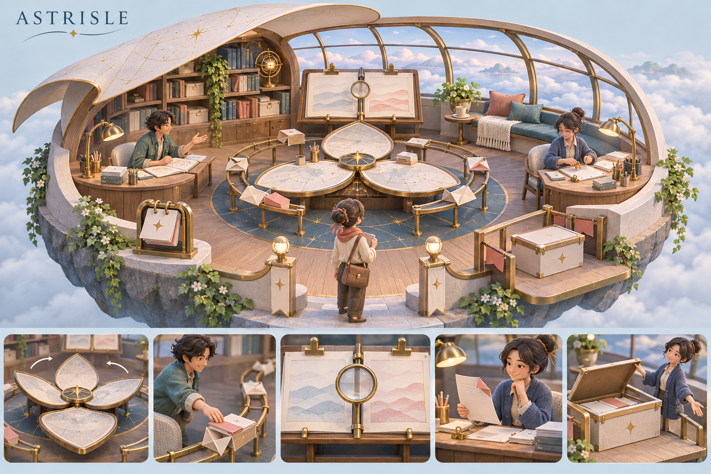

# Astrisle 场景与角色动作设计

日期：2026-11-11  
状态：创意方案，待评审；尺寸、动作时长与性能预算都是待验证的设计值。  
配套：[总体设计](2026-11-11-astrisle-system-design.md)、[开发计划](../plans/2026-11-11-astrisle-v0.1.md)。

**开发阶段追加要求（2026-11-11）：** 用户查看开发版后要求场景更丰富、3D 区域更大，并可创建多块岛屿。本阶段采用“一工作空间对应一岛屿”的实现约定，增加可选取的 3D 群岛总览、创建/命名/切换入口；默认收起详情面板、缩窄导航，场景成为主视图。下文描述单座岛屿的内部布局，群岛不共享项目权限或任务状态。新增植物、步道、池塘、地形层次和轻量环境动作；精细美术仍在后续阶段。



概念图使用内置 imagegen 生成，[完整提示词](../../concepts/astrisle-star-island-prompt.md)已保存。图中入口台阶只表达外部高差，实际工作地面仍为一层；中央轨道需在灰盒阶段验证可达性，不照图封闭操作站位。

## 1. 方向：悬浮星岛上的环形工坊

这是一座被改造成工作室的小型观星站：白天漂在云海上，傍晚窗外出现星光。屋顶像翻开的书页，地板是一块不完全对称的圆形平台。中央桌可以分瓣展开，沿外侧弧线布置工作湾、对照架、交付港和休息角。材料有磨砂金属、浅木、布料和少量半透明玻璃，既像可以生活的地方，也能清楚看见工作正在发生。

最值得记住的视觉是**展开的星图桌与环绕它的折页传递轨道**。其他家具与光效保持克制，避免每一件物品都发光、漂浮或抢镜。

### 1.1 比较过的三种方向

| 方向 | 独特性 | 取舍 |
|---|---|---|
| 星岛环形工坊（推荐） | 星图桌、环形协作、弧形窗与云海；工作与生活自然连在一起 | 单层布局能让主要工作一眼可见；复杂度集中在中央桌和少量标志动作 |
| 树冠中的分层书屋 | 吊桥、升降书篮、树枝工位，空间温暖 | 多层遮挡和绕路会增加镜头与导航负担，适合以后扩展 |
| 移动列车中的工作车厢 | 随旅途变化的窗景、行李交付、车厢协作 | 长条动线难同时看见两位伙伴；“旅行”容易压过工作关系 |

选择星岛是本次设计建议，不是已确认的用户审美偏好。无论最终选哪种美术，任务、产物和权限语义保持一致。

## 2. 平面、动线与镜头

建议灰盒范围约 12 × 10 米，仅用来建立人物比例；不追求建筑测绘精度。可活动地面保持一层，窗边背景可以有高差。用户与伙伴不需要上下楼才能完成工作。

```text
                       北：弧形天窗 / 云海
             ╭──────────────────────────────╮
             │  星册书架       窗边坐榻 / 茶台  │
        ╭────┤                              ├────╮
        │甲工作湾       可翻转的对照架          乙工作湾│
        │  ○                                      ○ │
        │       ╭────── 内侧步行环 ──────╮           │
        │       │    分瓣星图桌 / 委托端    │           │
        │       │    折页传递轨道 / 样品端  │           │
        │       ╰─────────────────────╯           │
        │  回信匣                              交付港 │
        ╰────╮          宽入口              ╭──────╯
             ╰───────── 用户落点 ────────────╯
                         南：默认镜头
```

**布局逻辑：** 从入口先看见“需要我做什么”，再看见当前工作，最后看见可带走的成果。环路避免工位之间只有一条狭窄通道。任务不会为了演出被送去一个看不见的房间。

| 区域 | 大致坐标（米，桌心为原点） | 作用与识别物 |
|---|---|---|
| 中央星图桌 | (0, 0) | 目标、计划、对照；三块可展开桌瓣，桌心是当前委托 |
| 甲工作湾 | (-3.8, 0.6) | 更有工具感的可换职责工位：小抽屉、可折工作灯 |
| 乙工作湾 | (3.8, 0.6) | 更有整理感的可换职责工位：翻页架、彩色夹子、侧边收纳 |
| 对照架 | (0, 2.8) | 两版产物并排，固定的观察站位，不强制角色站齐 |
| 回信匣 | (-3.6, -3.1) | 从上次离开后的变化、待答问题；翻板提示而非不停弹窗 |
| 交付港 | (3.6, -3.0) | 可以掀开的成果盒，分项成果各有一个可点击标签 |
| 星册书架 | (-2.8, 3.8) | 用户主动保存的模板和决定；书脊显示来源项目 |
| 窗边坐榻 | (2.1, 3.8) | 想法讨论、休息和生活动作；聊天转委托需要明确动作 |
| 入口 | (0, -4.2) | 用户化身初始位置与全景重置参照 |

坐标轴：X 左右、Z 前后、Y 高度；上述二维坐标表示 (X, Z)。内环建议净宽至少 1.2 米；站位占用按约 0.6 米半径进行灰盒验证。

### 2.1 镜头

- 默认南侧斜俯视，约 40°～50°，保证两位伙伴、桌面和交付港同时可见。
- 支持有限旋转、缩放与“回到全景”；不默认自由第一人称漫游。
- 点物件直接打开面板；“带我看看”才平滑移动镜头，阅读时不自动抢镜。
- 遮挡前景的屋顶/墙面淡出；人物与交互热点保持可见。小道具只在近景拾取。
- 用户可以点地面走动，但移动不构成操作前提；键盘面板拥有同等能力。

## 3. 五个有辨识度的工作时刻

### 3.1 接到委托：桌面像航图一样展开

用户提交后，只有收到运行时受理回执，桌心才出现委托卡。两块桌瓣轻轻展开，当前目标、主要分支和产物缩略卡沿轨道摆开。角色把手边物品推到一侧，靠近自己的工作区域。

“星点”代表真实任务节点，连线代表依赖；只显示关键节点，细节进入面板。不用星点数量或光亮强度冒充完成百分比。受理后立即可执行，展开动作可以跳过。

### 3.2 交接：折页桥与磁吸文件夹

产物已保存且可读时，共享桌出现带版本标签的文件夹。靠近桌边的伙伴可以合上夹子，沿轨道推送一小段；远处的伙伴只抬手示意，文件夹在共享端就地可用。轨道上的折页结构形成短暂的“桥”，作为视觉连接。

接收者实际开始处理该版本时，才播放取件与展开。文件夹的业务位置是共享产物，手中的道具只是它的表现副本，不把寻路、碰撞或手部 IK 当成交接成功条件。

### 3.3 发现问题：双页透镜

复核伙伴把两版样品放上对照架，转动一个小透镜/框架，对应差异处出现一枚有文字入口的书签。点书签可打开实际输入、输出和问题位置。

文件夹已经生成不代表复核通过。没有结构化定位证据时，只使用普通问题标签，不编造一个看似精确的错误单元格或代码行。

### 3.4 返工：折返便签

问题记录和返工任务保存后，一张纸条折起一角，沿桌边滑向负责人的接件盘。负责人看一眼、把便签夹到当前工作旁，继续修改。动作温和明确，避免跺脚、砸桌等会把正常复核表现成灾难的表演。

上一版夹子留在对照架历史页；新版本复验后换入新页，旧失败记录可打开。正在处理其他工作时，便签停在队列位置，不让角色突然中断工具调用假装接活。

### 3.5 交付：成果在窗口靠港

待验收时，临窗交付港打开一只浅盒，内部按文件类型呈现可编辑文件、项目包和检查记录。伙伴把盒盖扶起、向用户侧退一步；没有漫天纸屑，也没有自动播放“全部成功”。

部分交付使用明确的“已有成果，仍有待办”标签和未封闭隔格。接受某项只为该项盖章；写回原项目通过面板另行操作。归档时盒子变成书架上的可追溯册页，但只有用户选择保存的内容才进入可复用书架。

## 4. 两位伙伴的性格

首轮采用兼容同一基础骨架的预制角色，服装和道具区分轮廓，避免先投入完整自研角色管线。人物身份名称暂用甲/乙，正式命名属于后续美术确认。

| 维度 | 伙伴甲：探索型 | 伙伴乙：整理型 |
|---|---|---|
| 工作习惯 | 把资料摊开，找到线索后用笔轻点，再开始下一步 | 先对齐资料，逐项夹标签，复核时把两份文件拉到等距 |
| 等待时 | 倚在桌沿转笔，偶尔望向相关工位 | 合上当前文件，把下一份放到手边，再整理夹子 |
| 发现问题 | 微微侧头、展开局部、写短便签 | 沿差异滑动书签，核对来源后放上问题夹 |
| 成果可交付 | 推开一小段空位，把成果朝用户方向摆正 | 逐项整理盒内隔格，然后合起检查册 |
| 生活动作 | 让小纸风车转一下，擦窗看云，伸懒腰 | 扶正歪书脊，给窗边植物浇一点水，捧杯停顿 |

性格只影响动作、摆设与表达语气，不暗示模型等级、权限或能力差异。交换任务后仍保留各自习惯。复核、编程和办公都可以由任意伙伴承担。

用户化身的功能是参与感：可坐、走、看物件、向伙伴打招呼。点头、寒暄、靠近或坐下都不会自动批准动作、派单或扩大资料共享范围。

## 5. 动作清单与真实触发

采用少量基础动作加可组合道具动作，先做到连贯，再增加动作数量。

| 动作 ID | 演出 | 触发事实 | 建议时长与中断 |
|---|---|---|---|
| `idle_breathe` | 呼吸、轻微换重心 | 无当前演出 | 循环；随时融合退出 |
| `walk` | 走向站位 | 存在有效视觉移动目标 | 随距离；不影响任务执行 |
| `turn_look` | 转身与目光关注 | 用户选择或新的相关事件 | 0.4～0.8 秒；可中断 |
| `sit_stand` | 坐下、起身 | 站位与座位可用 | 1.0～1.5 秒；道具可回收 |
| `read_compare` | 展开、并排阅读 | 正在读资料/复核的真实任务阶段 | 3～6 秒循环；工具结束即退出 |
| `work_type` | 短打字、停顿思考 | 正在进行代码/文字编辑阶段 | 2～5 秒分段；不能单凭模型请求发出就无限打字 |
| `mark_note` | 标注、贴夹子 | 已记录检查项或问题 | 0.8～1.4 秒；事件过期就跳过 |
| `plan_spread` | 推开纸面、指向分支 | 新计划已保存 | 1.2～2 秒；合并重复更新 |
| `handoff_push` | 合夹、沿桌推送 | 产物版本已登记可读 | 1.0～1.8 秒；文件始终可点 |
| `receive_open` | 取件、打开 | 接收者开始处理指定版本 | 0.8～1.4 秒；不能提前取件 |
| `question_place` | 把问题卡立在桌边 | 输入请求/审批确已保存 | 0.8～1.2 秒；不挥手催促循环 |
| `rework_attach` | 接住便签、夹到资料旁 | 返工已被指派 | 0.8～1.4 秒；忙时仅摆到队列 |
| `delivery_present` | 扶起盒盖、退半步 | 最终成果进入待验收 | 1.5～2.5 秒；用户操作优先 |
| `stretch` | 伸展肩背 | 低优先级生活时隙 | 2～3 秒；任务事件打断 |
| `cup_pause` | 拿杯、停顿、放回 | 低优先级生活时隙 | 3～5 秒；持物状态有回收路径 |
| `plant_care` | 短暂照料植物 | 空闲且站位空闲 | 4～6 秒；不占用工作必经道 |
| `greet` | 点头、小幅招手 | 用户主动问候 | 0.6～1 秒；不改变业务状态 |

首批制作：呼吸、走路、转向、坐起、阅读、工作六类基础动画，以及指向/递交/取件/标注/呈现五类上身动作。生活动作在第二轮制作，先复用骨架和手持道具接口，避免一开始就做数十条完整动画。

“等待模型响应”使用安静的翻阅或停顿，文字明确显示正在等待响应；“排队”不演工作；“连接中断”停止新的业务演出并显示失联状态。生命周期动作不是任务耗时估计。

## 6. 动作导演系统

动作导演是客户端的表现模块，只消费业务事实，不能调用任务完成、授权或文件写入接口。

输入分成三组：当前 `ProjectSnapshot`、收到的业务事件、用户交互/偏好。输出是可丢弃的 `SceneIntent`：

```ts
type SceneIntent = {
  id: string;
  sourceEventId?: string;
  actorId: string;
  kind: string;
  targetAnchorId?: string;
  artifactVersionId?: string;
  priority: 'user' | 'business' | 'ambient';
  expiresAt: string;
  interruptible: boolean;
};
```

规则：

1. 同事件只入队一次；事件已不符合当前快照就丢弃。后台完成了五次交接，回来只呈现当前成果。
2. 用户点击/选中优先，其次新的业务变化，最后生活动作。角色的视觉动作锁不阻塞真实工具运行。
3. 单角色最多保留一个待播关键动作；新版本交付可替代旧版本待播演出。面板时间线仍保留全部事件。
4. 站位使用带到期时间的视觉预约。等待超过建议 1.5 秒，转为原地示意；业务照常进行。
5. 可中断动作在下一个安全关键帧放回道具；超时、卸载或模型切换时清理道具、恢复姿态与站位。
6. 减少动效模式下，用静态道具/文字和不超过 150 毫秒的轻淡入替代走路与递送；可完全关闭场景。
7. 重连从快照重建，不补演。切换项目销毁旧项目的队列、道具引用和视觉预约。

导航采用固定房间导航网格/路点和局部避让。人物胶囊体、站位和桌边锚点由灰盒验证，不用业务任务充当寻路目标。手部 IK、道具对齐和脚底修正作为表现质量层，可降级为简单示意。

## 7. 状态、道具和面板映射

| 真实事实 | 场景表示 | 点击入口 |
|---|---|---|
| 新委托已受理 | 桌心项目卡，分瓣桌展开 | 目标与验收条件 |
| 任务被指派但排队 | 工位侧边待办夹 | 队列与依赖 |
| 正在执行 | 对应工作姿态，短文字当前步骤 | 当前任务与工具记录 |
| 等输入 | 竖起的问题便签 | 问题、影响、答复 |
| 等审批 | 有锁形标记的动作单，明确文字 | 目标、参数、后果与授权 |
| 产物已保存 | 共享轨道上的版本文件夹 | 产物预览与来源 |
| 复核发现问题 | 对照架书签 | 问题定位与复核证据 |
| 部分交付 | 交付港部分填充，标“仍有待办” | 可取成果与缺口 |
| 待用户验收 | 打开的完整成果盒 | 验收清单，不自动应用 |
| 用户接受 | 该项标签盖章 | 接受记录；写回仍是独立操作 |

业务状态必须有文字。颜色、动作、姿态与声音都是辅助。任何失效的产物道具都显式标为不可用，不能残留成成功展示。

## 8. 场景的日常生活

生活感来自少量持续的变化：晨间窗影、夜间台灯、杯子摆放、书架逐渐留下用户选择的成果。时间变化取本地时间但可锁定，环境不暗示后台实际工作的时长。

- 两位伙伴在空闲时可互相让路、短暂点头或一起看窗外，不自动产生任务、共享材料或模型聊天费用。
- 用户坐到窗边可以进入想法讨论；“整理成委托草稿”才写出草稿，“开始工作”才派单。
- 工位上只展示当前项目的少量关键物件，历史进入抽屉面板，避免运行一周后桌面堆满几百个对象。
- 音效包括纸张、滑轨、杯底与远处风声；用户阅读时降低，关闭音效不损失状态信息。
- 环境事件低频、短暂。角色不持续向用户索取关注，也不因用户离开表现“被抛弃”。

## 9. 画面规范与性能目标

视觉方向：轻写实的手工模型质感，柔和但有清楚轮廓；不使用满屏全息 UI。基色为云纸白 `#E7EEF0`、深海蓝 `#203D50`、木纹米 `#BEAD8D`、黄铜 `#BA994F`，少量潮青 `#4E9690` 与问题珊瑚红 `#C76A68`。颜色仍须做对比度检查。

普通面板使用清楚的中文无衬线字体，优先系统字体；标题约 20/28，正文 14/22，小字 12/18（像素）。代码区域使用等宽字体，不能为了世界观把文件名、路径和错误说明写成难懂的隐喻。

初始画质预算仅作探针目标：

- 1080p，一个用户化身和两位伙伴；标准档尝试 60 FPS，低档至少尝试 30 FPS，记录机器与实际数据后调整。
- 静态环境尽量合批/实例化，烘焙主要光照；只保留少量动态阴影，不启用默认全屏重后期。
- 角色约 15k～30k 三角形/人、环境约 150k 三角形作为初始预算；主要纹理不超过 2K，具体以读图和 GPU 数据决定。
- 隐藏窗口停止场景帧循环；只有文字面板可见时不创建 WebGL。GLB 加载失败仍有可用任务面板。
- 概念图中的云海、弧形屋顶和光照是美术意图，不直接转成无限体积云、物理建筑或高成本实时效果。

## 10. 制作顺序与验收

1. **纸面与概念图：** 确定轮廓、三个主要焦点、站位和五个标志时刻。
2. **灰盒分镜：** 基础几何体、简化角色，验证环路、遮挡、点击和中断；只用标记清楚的模拟状态。
3. **业务接线：** 同一快照驱动面板与场景，验证真实交接、返工、部分交付和断线恢复。
4. **核心资产：** 中央桌、两工作湾、交付港、预制骨架与工作动作；随后再增加生活动作与装饰。
5. **质量检查：** 看站位冲突、道具穿插、动画重复、误触、字体和性能；降级与无 3D 路径同测。

空间验收须观察用户能否在约 10 秒内找到当前任务、阻碍和成果，并记录实际时间与误操作；这是待验证的易用性目标。动作验收必须覆盖站位占满、短任务提前完成、重复事件、切换项目、减少动效和资源加载失败。

概念图用于沟通气质；最终地面尺寸、信息架构、点击范围和业务语义以本文与总体设计为准。不能把漂亮截图当成协作能力完成的证据。
