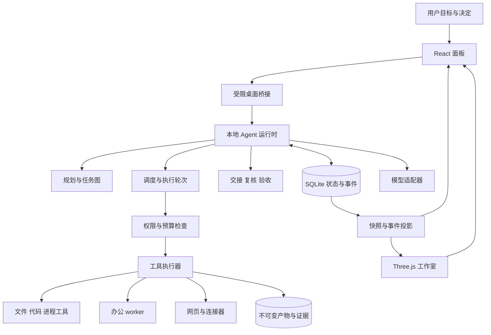

# Astrisle 总体规划与系统设计

日期：2026-11-11  
状态：规划草案，待评审；尚未实现或实测。  
依据：[原始设计文档](../../../Astrisle-设计文档.md)及本次用户补充。配套：[空间与动作设计](2026-11-11-astrisle-spatial-design.md)、[开发计划](../plans/2026-11-11-astrisle-v0.1.md)。

## 1. 产品目标与本次确认

Astrisle 是一个能接手真实工作的多 Agent 工作室。用户可以让伙伴从零创建项目、完整改动已有项目、处理办公资料，并持续推进跨多个步骤的工作。伙伴负责调查、规划、执行、交接、复核、返工和整合，用户主要负责交代目标、必要决策和验收。

本次用户明确补充：

- 要能创建、修改和推进项目，承接写代码和办公等不同类型任务。
- 规划不能围绕原文档的某个单一事例展开。
- 角色动作、场景布局要有创意。

因此，首版按“通用任务运行时 + 可组合工作工具 + 有生活感的 3D 工作室”组织。演示委托用于检验泛化能力，不作为生产代码中的固定流程。界面不能只有聊天和角色散步；交付也不能只有一段完成说明。

本目录当前只有原始设计文档，没有工程、代码、资产或 Git 仓库。本规划中的文件结构、接口、测试与性能指标均为拟建目标，不代表已存在的能力。

## 2. 首版范围

### 2.1 四类完整工作

| 场景 | 用户交代的目标举例 | 首版必须实际完成的链条 |
|---|---|---|
| 从零创建项目 | 创建一个可运行的个人资料整理工具 | 澄清必要约束、选择适合的技术、创建文件和配置、按授权准备依赖、实现、运行检查、交出可继续开发的完整项目 |
| 接手已有项目 | 看懂现有项目，增加能力并修复相关问题 | 调查结构与约定、保存输入基线、制定计划、多文件修改、运行已有检查、处理集成冲突、交付差异和操作说明 |
| 完成办公工作 | 整理资料，修改工作簿，形成报告和演示稿 | 读取授权资料、整理来源、计算与核对、创建或修改可编辑文件、检查内容及版式、交付文件与证据 |
| 持续推进工作 | 上次的项目继续做，加入新的要求 | 恢复历史、读取最新文件、确认仍有效的约束和授权、调整任务图、保留已认可成果、继续执行并形成新交付版本 |

上述例子不是任务白名单。运行时接收自然语言目标，结合现有材料和已安装工具生成不同计划。第一版不承诺覆盖所有应用、文件格式和外部服务，但必须清楚显示可用能力、缺少的能力和可行替代路径。

### 2.2 能力层次

| 层次 | 首版必须具备 | 后续按使用需要扩展 |
|---|---|---|
| 通用工作 | 文件检索、读写、目录创建、结构化编辑、进程执行、授权网页读取、证据与产物登记 | 更多检索源、远程执行环境 |
| 编程 | 新建项目、理解现有仓库、跨文件修改、依赖准备、构建测试、版本整合、冲突预览、受控写回 | 更多语言环境、部署平台与远程开发 |
| 办公 | Markdown/纯文本、DOCX、XLSX、PPTX 的常用创建与修改；来源追踪、数据核算、预览与版式检查 | 特殊模板、高级图表、更多格式与原生应用深度控制 |
| 协作 | 两位真实 Agent、动态任务图、交接、复核、返工、部分交付、持续项目上下文 | 更多伙伴、跨机器协作 |
| 交互 | 一间有创意的工作室、用户化身、两位伙伴、完整普通面板、键盘操作 | 房间装饰、更多角色、更多生活互动 |
| 外部工作 | 内部工具注册机制；连接器就绪后才启用对应读写动作 | 邮件、日历、云文档、项目管理和发布服务适配器 |

公开工具市场、多人联机、无限场景和任意图片自动生成完整角色不占首版关键路径。具体外部服务不预先承诺全部接入；开放式任务能力通过工具组合扩展。

### 2.3 首版成立条件

同一个产品二进制、同一套通用运行时必须完成不同领域的委托。至少包括新建代码项目、修改已有项目、独立办公交付，以及基于历史的新一轮委托。每一类都要有真实工具结果；至少一单包含由另一位伙伴发现问题并自动返工的完整路径。多 Agent 协作和办公能力都属于首版。

## 3. 建议技术路线

以下是本次规划建议，尚未获得用户逐项选型确认。

| 部分 | 建议 | 理由与需要验证的事项 |
|---|---|---|
| 客户端 | React + TypeScript + Vite | 面板、复杂交付和场景共享同一套类型与选择状态 |
| 3D | Three.js + React Three Fiber；glTF/GLB 资产 | 延续原文档方向，场景作为业务状态的可替换呈现层 |
| 桌面壳 | 首先验证 Electron | 便于统一前端与 Node 运行时开发；启动、内存、后台耗用和打包必须实测 |
| 业务运行时 | TypeScript / Node，独立进程 | 调度、恢复和模型调用不依赖窗口或渲染帧 |
| 状态存储 | 本地 SQLite + 文件产物库 | 小规模本地事务、事件顺序、可恢复记录；不引入远端数据库作为首版前提 |
| 办公执行器 | 独立 Python worker：python-docx、openpyxl、python-pptx | 同时覆盖常用文件的创建与修改；运行时通过版本化 JSON 协议调用 |
| 办公预览 | 可配置的 LibreOffice 转换/重算适配器 + 页面图片检查 | 文件可解析、版式可读、在指定应用打开是不同证据等级 |
| 模型 | ProviderAdapter 接口，先接一种支持工具调用的实际模型服务 | 不把供应商会话、模型状态或计费协议混进项目状态；模型和凭据由配置提供 |
| 验证 | TypeScript 单元/集成测试 + Python worker 测试 + 桌面端到端测试 | 核心状态用确定性测试；真实模型验证泛化，不能用脚本演出代替 |

React 与 R3F 必须匹配主版本；当前官方安装指南明确列出 React 19 与 R3F 9 的组合。正式初始化时锁定验证过的完整依赖版本，不把“最新版”写成永久约束。[R3F 安装指南](https://r3f.docs.pmnd.rs/getting-started/installation)

桌面方案对比：Electron 作为优先验证路线；Tauri 保留为体积/后台资源不达标时的备选，但需要处理 Rust 壳与独立工具运行时的集成；纯浏览器方案不承担本地文件和进程执行的首版桌面职责。Tauri 的系统 WebView 方案与 Electron 的运行时包装不同，不能未经实测就宣称哪一方在本项目更快。[Tauri 架构](https://v2.tauri.app/concept/architecture/)

不在首版引入另一个同时掌管任务持久化和恢复的编排框架。先实现薄的 Agent 工具循环与明确的领域状态机；以后采用 SDK 时也必须经过现有权限、产物和审计接口。SDK 可替换模型交互，不能越过业务边界。

## 4. 系统边界



### 4.1 进程职责

- **Electron 主进程：** 窗口、托盘、文件选择、凭据存取、运行时生命周期、IPC 来源校验。只暴露明确命令，不把任意 shell 或任意文件 API 给渲染进程。
- **Renderer：** 普通面板与 3D。只能发送命令和消费快照；失联显示最后确认时间，不能自行判定成功。
- **Runtime：** 唯一业务状态写入者，调度 Agent，生成授权工具调用，持久化结果和事件。
- **Executor：** 工具权限复核、受控工作目录、进程组、文件结果、超时与停止。办公 worker 不直接写业务数据库。

首轮可由 Electron `utilityProcess` 承载 Runtime，它提供独立 Node 子进程与消息端口；Runtime 的核心代码不导入 Electron，以便无界面运行及未来替换宿主。[utilityProcess](https://www.electronjs.org/docs/latest/api/utility-process)

关闭窗口默认收进托盘并提示后台工作情况；“退出 Astrisle”要求暂停调度、收敛在途调用并持久化。主进程崩溃或关机不保证继续运行，下次启动走恢复流程。此处的独立指业务与渲染解耦，不宣称进程能脱离所有宿主永久存活。

### 4.2 内部协议

使用版本化命令、查询和事件封装，先走桌面 IPC 与进程消息；不为本地首版暴露未认证 HTTP 服务。

```ts
type CommandEnvelope<T> = {
  schemaVersion: 1;
  requestId: string;
  workspaceId: string;
  commissionId?: string;
  expectedRevision?: number;
  payload: T;
};

type EventEnvelope<T> = {
  schemaVersion: 1;
  eventId: string;
  commissionId: string;
  sequence: number;
  revision: number;
  occurredAt: string;
  causationId: string;
  payload: T;
};
```

业务写命令按 `requestId` 幂等：同编号同内容返回原回执，同编号不同内容拒绝。项目变更使用 `expectedRevision` 防止覆盖新决定。事件按委托递增，客户端发现序号缺口就补取快照；恢复不播放历史动作队列。

## 5. 数据与状态

### 5.1 核心记录

| 记录 | 必须包含的内容 |
|---|---|
| Workspace | 长期项目标识、根目录、资料范围、约定与最新项目索引 |
| Commission / RequirementRevision | 本次目标、验收条件、来源、授权快照、预算、需求修订记录 |
| Agent / Avatar | 稳定 Agent 身份、能力配置；独立的形象、动作风格和显示位置 |
| Task / Dependency | 负责人、输入引用、产物约定、验收责任、依赖类型、计划版本 |
| TaskRun | 独立运行编号、租约、当前阶段、模型用量、执行心跳与结束原因 |
| ToolCall | 具体参数摘要、授权引用、执行回执、stdout/stderr、退出码、副作用分类 |
| ArtifactVersion / Lineage | 不可变版本、内容哈希、输入版本、生成调用、介质类型、可读性 |
| Handoff / Review / Finding | 谁把哪一版交给谁、检查结论、证据位置、返工归属 |
| InputRequest / Approval | 具体问题或动作、影响范围、状态、回答人、到期/撤销条件 |
| Acceptance / ApplyOperation | 分项接受记录、最终产物清单；另行登记写回预检和结果 |
| Decision / ContextNote | 来源、适用范围、确认状态、有效版本；不保存隐藏推理或访问密钥 |
| Event / CommandReceipt | 事务事件、递增游标、命令去重和结果查询 |

存储采用“当前状态表 + 同事务追加事件”的形式，不先搭建全量事件溯源系统。SQLite 单写事务约束意味着写入应由 Runtime 汇总，工具并行不等于数据库写入任意并行。[SQLite 事务](https://www.sqlite.org/lang_transaction.html)

数据库、日志和产物默认在本地应用数据目录，禁止把 WAL 数据库放到网络共享；授权的外部资料可导入本地快照。备份走数据库备份接口/受控停写，不直接复制运行中的单个数据库文件。[SQLite WAL](https://www.sqlite.org/wal.html)

### 5.2 三层状态与控制开关

- **委托生命周期：** `draft → accepted → active → awaiting_acceptance → accepted_by_user`，另有 `cancelling → cancelled` 与 `terminated`。部分成果随时可取走，不构造假“全部成功”。
- **子任务：** `queued / waiting_dependency / running / waiting_input / waiting_approval / awaiting_review / rework_required / passed / failed / cancelled`。
- **执行轮次：** `created / running / succeeded / failed / stop_requested / stopped / outcome_unknown`。结果未知不能直接当作失败重新写一次。
- **独立控制：** `dispatchPaused` 与 `pauseReason` 控制新工作派发；用户暂停、预算限制、恢复核查不会混为生命周期结束。连接状态独立显示。

用户改变需求时新增 `RequirementRevision`，按影响集调整任务和证据。已经接受的旧成果保留接受历史；若新要求需要重做，则生成新的候选版本，不改写历史事实。

## 6. 多 Agent 如何持续工作

### 6.1 职责与动态计划

首版两位可见伙伴，两位都有执行能力；一位兼任本委托的协调者。角色外形和工位不决定能力。协调是项目职责，复核是某个产物的职责，不能把所有动作固定成“甲永远写代码、乙永远写说明”。

规划 Agent 产出结构化 `PlanProposal`：任务、输入输出、依赖、负责人、验收责任和分解理由。运行时校验：依赖无环、引用存在、没有扩大权限、每项需求有覆盖、复核不会等到自己通过才开始。最初允许先调查再细化，任务图可以修订。

任务执行采用 `观察 → 决定下一步 → 请求工具 → 读取结果 → 更新计划/交付` 的循环。生成文件、读文件、运行测试、处理表格均是通用工具调用。模型可以提出新增任务，但不能直接把任务标成通过或替用户授予权限。

### 6.2 调度与交接

- 同一工作区首版最多一个活动的可写委托，后续委托可存草稿；内部多任务并行不受此限制。受理事务取得工作区写租约，暂停或待验收时保留它；用户接受、取消或终止且确认写入进程退出后释放。已经接受的交付仍由独立写回操作再次取得写锁。
- 首版每位伙伴同一时间最多一个执行任务，总并发建议为 2，均可配置。
- 只派发依赖满足、预算允许且有名额的任务；排队不展示成正在执行工具。
- 依赖区分 `artifact_available` 和 `task_passed`。复核可以消费生产任务已保存的候选产物，不需要等待生产任务先通过复核，避免死锁。
- 输入解析成确定版本后才启动 `TaskRun`。交接单包含版本、用途、下一步和验收条件。
- 工具前后检查高优先级控制消息。协调者自己的执行任务在安全边界让出控制轮次，不能因“正在写代码”无限拖延对新问题的处理。
- 对同一逻辑产物，作者和复核者分离；两位伙伴可交叉复核不同产物。自检保留，但不冒充另一位伙伴的复核。

### 6.3 返工与证据过期

复核结果为 `passed / changes_requested / unable_to_verify`。需修改时，生成关联原任务和问题证据的返工任务；每次返工新增运行与产物版本。原失败记录永远保留。

所有检查和衍生产物记录输入版本。当采用新版本替换交付候选时，只将消费旧版本的相关检查、摘要及文件标为过期。独立分支不重跑。任务完成状态与当前交付证据有效性分开，历史成功不等于当前验收仍有效。

最终进入待验收前，运行时逐条检查：原始/最新验收条件已有对应最终产物、检查结果适用该版本、没有未处理的阻塞/返工/冲突。缺少指定应用验证时，允许交出部分成果并标明缺口。

### 6.4 不写死工作流

通用运行时中禁止按演示项目名称选择固定任务图。以不同目标、不同输入结构、不同交付组合测试规划能力；增加一次未参与开发的委托作为泛化验证。确定性模型替身仅用于状态机测试，真实模型试跑单独记录。

## 7. 工作工具与项目改动

### 7.1 工具协议

每个工具声明名称、版本、输入/输出 schema、权限作用域、可取消性、超时、预检方式和副作用级别。副作用级别至少区分 `read_only / idempotent_write / reconcile_before_retry / external_effect`。

首版工具族：

- `workspace.*`：导入、新建、搜索、读取、结构化写入、补丁、文件清单与基线。
- `process.*`：运行获准程序/脚本、采集日志、查询、停止；命令及参数结构化，工作目录明确。
- `code.*`：差异、基线、任务工作副本、候选集成、测试证据。
- `office.*`：文件检查、创建、局部修改、数据核算、渲染、产物回读。
- `web.*`：授权 URL 读取与来源记录；搜索由接入的实际服务提供，未配置时不假装有搜索结果。
- `artifact.*`：注册版本、读取证据、交接、提交复核。
- `connector.*`：为未来服务保留统一注册边界；未实现工具不能出现在模型可调用清单中。

工具可组合，但不把模型输出当宿主指令直接执行。授权内的普通动作连续推进；具体参数或目标超出范围才申请扩权。

### 7.2 新建、修改、集成、应用

新项目从空工作副本开始，语言/框架遵循用户要求和已有资料，不把 Astrisle 自身的 TypeScript 技术栈强加给用户项目。

已有项目先记录授权范围内的实际文件基线，包括允许纳入的未提交和未跟踪文件。内部创建独立管理的项目副本，再在这个副本里使用 Git worktree 分配任务；不直接在用户原仓库创建工作树，以免未经写回授权修改其 Git 元数据。Git worktree 提供多个工作目录，不提供安全沙箱。[Git worktree](https://git-scm.com/docs/git-worktree)

整合时检查共同基础版本，并在候选版本上重跑受影响检查。合并冲突成为有负责人的任务，模型不能以“两个分支都通过”为依据跳过集成验证。

用户可以接受全部或某些交付，也可以先导出到新目录。写回原项目是独立 `ApplyOperation`：

1. 展示创建、修改、删除和重命名清单，绑定产物版本与基础清单。
2. 核查当前原文件状态；发生变化时进入冲突预览，不静默覆盖。
3. 写回前取得相关路径的可验证独占写入条件，并在锁内重新核对基础版本；新文件使用排他创建，不能依赖“先检查再写”的时间窗口。
4. 预存恢复副本并持久化逐文件应用日志；普通文件系统的多文件更新不宣称全事务原子性。
5. 中断时显示已写入/未写入清单；恢复前重新核查现状，不能自动用备份覆盖用户后续修改。

Windows 写入协调能力在完成并发写入测试前保持关闭；此时仍可查看完整成果并导出新目录。安全写回通过是首版发布门槛，不以永久隐藏按钮代替实现。

### 7.3 办公文件

DOCX 使用 python-docx，XLSX 使用 openpyxl，PPTX 使用 python-pptx 完成首版常用编辑。均先对副本操作，保留来源、变更范围和内容核对。其官方文档分别说明常用创建/修改能力；这不等于任意 Office 对象的完全保真支持。[python-docx](https://python-docx.readthedocs.io/en/latest/)、[openpyxl](https://openpyxl.readthedocs.io/en/stable/tutorial.html)、[python-pptx](https://python-pptx.readthedocs.io/en/latest/)

编辑现有复杂文件前检查宏、外部链接、嵌入对象及库不支持的特性；高风险文件保留原件，选择可用原生适配器或提交明确缺口。不能悄悄移除对象后仍宣称完成原任务。

验证分三层：结构和内容回读；数据/公式结果核验；目标应用打开与版式检查。仅保存公式字符串不算重算通过，截图不等于可编辑文件。LibreOffice 可用于独立转换进程，必须记录真实使用的应用与版本，不将其报告成 Microsoft Office 验证。[LibreOffice 启动参数](https://help.libreoffice.org/latest/en-US/text/shared/guide/start_parameters.html)

## 8. 权限、上下文和连续性

### 8.1 授权模型

委托授权由读取根目录、可写副本、允许程序/脚本、网络目标、数据外发范围、是否允许应用和预算组成。授权按项目与本次委托生效，不从历史聊天、文件文字或其他伙伴消息继承。

Executor 独立规范化路径并检查作用域；处理 Windows 大小写、路径分隔符、`..`、符号链接/junction、UNC 与重解析点。首版对不能可靠判定的路径拒绝写入并报告原因。需要任意程序/脚本执行时，清楚区分可信本机执行与隔离执行。

可信本机执行可用于用户授权的真实项目，但不是对恶意脚本的隔离承诺。面向任意不可信项目/公开分发前，必须另行验证文件、网络、凭据、资源及子进程隔离。Renderer 的 sandbox 也不等于工具代码的沙箱。桌面桥接使用 `contextIsolation`、禁用 Renderer Node 权限、校验消息来源和内容安全策略。[Electron 安全指南](https://www.electronjs.org/docs/latest/tutorial/security)

模型密钥由主进程的系统加密存储管理，只按需交给模型适配器，不放入子进程通用环境或项目历史；Windows 上使用系统保护仍不能防御同一用户权限下的恶意本地进程。[Electron safeStorage](https://www.electronjs.org/docs/latest/api/safe-storage)

### 8.2 项目上下文

上下文分为项目事实、用户决定、当前任务输入、工具观察与交付历史。每条摘要带来源与版本；读取文件后变更的摘要必须过期。只给 Agent 发送当前任务需要且获准的上下文，跨项目默认隔离。

首版使用路径/名称/全文检索与结构化索引即可，不先引入向量数据库。持续项目可复用已确认决定和指定模板，但开启新委托时重新检查资料权限和现状。模型会话压缩时保存“目标、已完成、未完成、关键文件、阻塞、下一步”，不能仅靠聊天全文恢复。

### 8.3 控制与预算

支持补充要求、暂停、恢复、停止、调整预算、分项验收。建议初始并发 2；单次瞬时错误最多重试 2 次；语义返工最多连续自动尝试 3 轮后提出带证据的问题。总步数、时间和费用限额可配置，长任务可在检查点续跑。没有可靠价格数据时只记录实际 token/调用量，不生成精确费用。

暂停停止新派发并在安全边界停下在途工作；取消请求发出后仍为取消中，执行器确认停止才取消完成。无法确认的外部效果列为待核查，绝不假装回滚。

## 9. 可靠性规则

| 失败条件 | 设计响应 |
|---|---|
| 派单回执丢失 | 原 `requestId` 查询/重试；不新建第二份委托 |
| 产物写完、业务事务未提交 | 文件先写临时位置、校验、变为不可变文件；随后事务登记并发事件。恢复扫描孤儿文件，未登记文件不算已交付 |
| 事务提交、事件未发出 | 持久事件队列重发；消费端按事件 ID/序号去重 |
| Worker 崩溃 | 标记调用结果未知并查询日志/输出/进程回执；非幂等操作先核查后决定 |
| Runtime 重启 | 获得单实例锁、递增运行代次；旧执行器提交需匹配租约/代次，旧进程未确认结束前不重复派发其写任务 |
| 输入/产物变更 | 哈希核验失败使对应证据失效；衍生成果按版本关系重算 |
| 磁盘满/文件被占用 | 保留已有有效版本；本次保存失败，不发可交付事件 |
| 3D 失效/窗口隐藏 | 停止或降频渲染，继续普通面板和业务任务；动画从不解锁依赖 |

这些规则提供可追踪、幂等处理与结果核查，不承诺任意外部系统的全局 exactly-once 执行。

## 10. 用户界面与 3D

日常默认打开工作室；“任务”入口随时切换成完整工作面板。场景和面板共用选中的委托、任务、产物与问题 ID，不形成两套逻辑。

首版面板：委托编辑器、项目总览、当前任务、问题与审批、成果/证据浏览器、分项验收与写回、模型与工具设置。主信息顺序为“结果和下一步 → 证据 → 技术细节”。

创意方向为**悬浮星岛上的环形工坊**：中央可展开的星图桌、两侧有不同生活习惯的工作湾、翻页式对照架、临窗交付港和入口回信匣。空间、动作、站位、状态触发、可访问性与资产预算见独立设计，不以一张概念图替代交互规则。

## 11. 验收矩阵

以下全部是未来验收条件，当前未执行。

| ID | 场景 | 判定证据 |
|---|---|---|
| A1 | 从空目录创建项目 | 实际文件、依赖清单、运行入口、构建/功能检查；两位伙伴承担真实工作 |
| A2 | 修改已有项目 | 基线、跨文件差异、同条件检查、集成验证、受控写回记录 |
| A3 | 独立办公任务 | 新建与修改文件均有案例；可编辑成果、数值来源、实际渲染/打开记录 |
| A4 | 连续项目与不同目标 | 重启后继续；新委托使用最新文件；改变目标后任务图与交付相应变化 |
| A5 | 真实协作与返工 | 并行准备、版本化交接、另一位伙伴发现问题、负责人返工和复验；无需用户传话 |
| A6 | 权限与部分交付 | 拒绝一项扩权不越权、无关分支继续、已有成果可取走 |
| A7 | 取消、回执丢失、恢复 | 重复命令不重复创建、结果未知先核查、停止确认真实、重启不重复非幂等动作 |
| A8 | 业务与场景一致 | 关闭 3D、阻塞站位、跳过动作时，产物与工具调用次数一致 |
| A9 | 原项目并发变化 | 应用前后竞争修改不被静默覆盖，应用中断有可核查清单 |
| A10 | 泛化能力 | 同一版本完成一项开发时未使用的委托，没有按名称硬编码计划 |
| A11 | 空间可理解、有性格 | 新用户能找到当前工作/问题/成果；两位伙伴可辨识；创意动作不伪造工作事实 |

## 12. 实施顺序与边界

1. **M0：状态分镜与工程探针。** 看清交代、工作、交接、问题、返工、交付；核查桌面壳、模型、办公 worker、写回协调的可行性。
2. **M1：可靠任务底座。** 状态、权限、存储、通用工具、模型循环和双伙伴调度；通过无界面故障测试。
3. **M2：真实工作能力。** 新建/修改代码项目与办公任务，候选集成、证据、返工、部分验收和写回；先用普通面板验证。
4. **M3：星岛工作室。** 将同一业务接入场景、角色和道具；此时创意概念在 M0 已验证，避免最后才决定美术。
5. **M4：首版验收与打包。** 跨场景真实模型测试、Windows 恢复/权限/性能、干净环境安装、最终证据包。

每个阶段是同一首版的里程碑，M1 或单一演示成功不能称为首版完成。没有人员投入和机器基准前不承诺日期；开发计划按依赖与可验收交付拆解，M0 后再估算排期。

仍需在实际开发启动时配置：模型服务与凭据、可信执行/隔离执行环境、办公验收应用及版本、目标 Windows 硬件。暂按单用户本机版本设计；公众分发、云协作和具体收费方式尚未由用户确认。它们不阻止本次规划，但会改变发布门槛。
